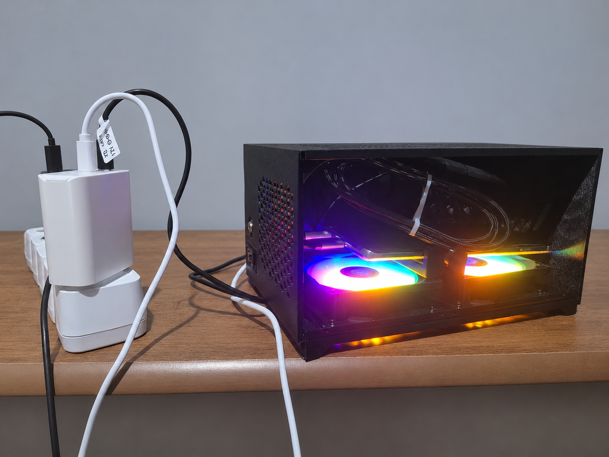
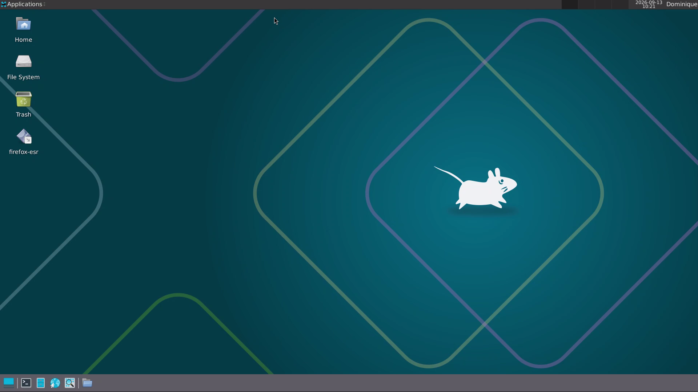
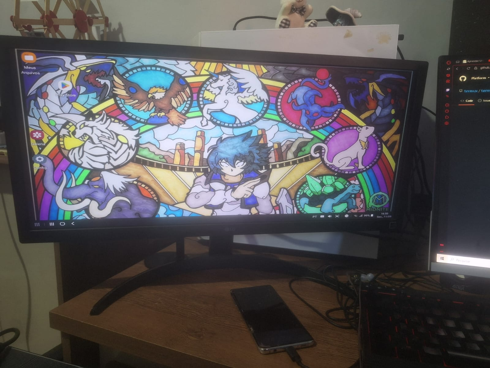

# Linudex

[Português](README.pt.md)

Linudex is a repurposing project that turns a Samsung Galaxy S10+ with a damaged display into a compact ARM desktop environment. The current software stack keeps Samsung DeX and Android as the hardware/driver layer, while Termux, PRoot-Distro, Debian and XFCE provide a Linux desktop environment.

## v0.1.0 — Functional Linux Desktop

Version `v0.1.0` marks the first stable graphical Linux milestone. At this stage, Linudex can boot Debian 13 ARM64 with XFCE through Termux:X11 and remain stable under the tested desktop workloads.

## v0.2.0 — Daily Driver Environment

Version `v0.2.0` builds on the stable Linux desktop established in v0.1.0 and turns it into a more practical daily-use environment. Audio, shared storage, desktop tuning, essential applications and startup automation are now integrated into the Linudex workflow.

## v0.2.1 — Automatic Startup Fix

Version `v0.2.1` is an update that fixes an auto-start bug in Linudex caused by an error when trying to run PulseAudio during a cold boot.

## v0.3.0 — Experimental x86/x86-64 Compatibility

Version `v0.3.0` adds optional execution paths for Linux and Windows x86-64 software using Box64, Wine, WineD3D and VirGL/ANGLE. Xonotic and Seraph's Last Stand launched in the tested environment, but demanding 3D workloads remained slow and several games did not run. The compatibility layer is experimental; the Debian/XFCE desktop from v0.2.1 remains the stable base.

## v0.4.0 — Physical Hardware Integration

Version v0.4.0 brings the Galaxy S10+, an 8-in-1 USB-C hub and two 80 mm fans together in a compact Nano enclosure. HDMI, USB-C and 3.5 mm audio extensions were integrated alongside a wireless keyboard/mouse kit. HDMI output was verified with an existing PC monitor, without requiring a dedicated display for this milestone.

Both fans operate as **exhaust fans** and were tested together. During YouTube 1080p playback, the reported temperatures were **35.2 °C with fans on** and **40.2 °C with fans off**, an observed gap of 5.0 °C. These results are preliminary and are not SoC temperature measurements. Instrumented verification of the cooling supply voltage and polarity is still pending.



### Completed

- Android shared storage integrated with Debian.
- PulseAudio bridge configured between Debian applications, Termux and Android/DeX.
- XFCE tuned for 1920×1080 use with 115 DPI and compositor disabled.
- Desktop panel, Whisker Menu and application shortcuts configured.
- Essential desktop applications installed and validated, including Firefox ESR, LibreOffice, VLC, Evince and archive utilities.
- Office-compatible fonts and Brazilian Portuguese language/spell-check support installed.
- `start-linudex.sh` and `stop-linudex.sh` expanded to manage audio, Termux:X11 and the Debian/XFCE session.
- Termux:Boot configured for automatic Linudex startup after Android boot.
- Termux:Widget configured for manual start/stop control when needed.
- Termux:X11 configured to open automatically when Linudex starts.
- Tested Linux x86-64 execution with Box64 and the OpenGL graphics bridge.
- Tested Windows x86-64 execution with Wine 9.18-staging and WineD3D 9.2.
- Validated DepotDownloader 3.4.0 ARM64 as an alternative to running SteamWebHelper for downloading authorized game files.
- Documented graphics performance, memory limitations and unsuccessful compatibility tests.
- Kept compatibility launchers separate from the existing automatic XFCE startup.
- Integrated enclosure, hub, video and external audio connections, and two 80 mm cooling fans with preliminary thermal testing in v0.4.0.

## Architecture

```text
Samsung Galaxy S10+
└── Android 12 / One UI 4.1
    ├── Samsung DeX
    ├── Termux:Boot / Termux:Widget
    └── Termux
        ├── PulseAudio
        ├── Termux:X11
        └── PRoot-Distro
            └── Debian 13 ARM64
                └── XFCE
```

This design intentionally keeps Android because it provides mature hardware support for the Galaxy S10+, including USB-C video output, audio routing and Samsung DeX. Debian runs as a userspace environment over the Android kernel rather than as a virtual machine.

The x86-64 compatibility paths use Box64 and an optional graphics bridge in addition to the desktop architecture shown above. Version v0.4.0 adds a physical assembly without replacing the software layers. See [Architecture](docs/architecture.md) for connection, power and airflow diagrams.

## Current status

The daily-driver environment established in v0.2.1 remains the stable base. Version v0.3.0 adds an experimental x86/x86-64 compatibility layer without changing the normal automatic desktop startup. Its gaming results are limited and documented, not presented as general playability.

The v0.4.0 build has a functioning enclosure, hub, video output, rear audio extension and active cooling in the tested assembly. A dedicated monitor has not yet been purchased, but HDMI works with an existing display. The fans operated during practical testing, while instrumented confirmation of the nominal 12 V profile, polarity and current remains pending; the charger produced faint noise under some low-load conditions. Thermal results must be interpreted as preliminary comparisons.

<p align="center">
  
</p>

## Documentation

- [System baseline](docs/baseline.md)
- [Architecture](docs/architecture.md)
- [Android debloat](docs/debloat.md)
- [Software setup](docs/software.md)
- [Hardware](docs/hardware.md)
- [Benchmarks](docs/benchmarks.md)
- [Troubleshooting](docs/troubleshooting/README.md)
- [Bill of materials](bom/components.md)

## Repository layout

```text
linudex/
├── README.md
├── README.pt.md
├── docs/
│   ├── architecture.md
│   ├── baseline.md
│   ├── benchmarks.md
│   ├── debloat.md
│   ├── hardware.md
│   ├── software.md
│   └── troubleshooting/
│       ├── README.md
│       ├── troubleshooting-v0.1.0.md
│       ├── troubleshooting-v0.2.0.md
│       ├── troubleshooting-v0.2.1.md
│       ├── troubleshooting-v0.3.0.md
│       └── troubleshooting-v0.4.0.md
├── images/
│   ├── benchmarks/
│   ├── build/
│   └── screenshots/
├── scripts/
├── configs/
└── bom/
```

Every Markdown document has a Portuguese counterpart using the `*.pt.md` suffix.

## Image organization

Use the image folders by purpose:

- `images/build/` — physical build progress, enclosure, hub and cooling assembly.
- `images/screenshots/` — DeX, Termux, Debian and XFCE screenshots.
- `images/benchmarks/` — benchmark captures and charts.

Avoid placing screenshots directly in `docs/`; documentation should reference the corresponding file under `images/`.

## Project scope

Linudex is an experimental reuse project. The goal is not to replace a conventional x86 PC in every workload, but to evaluate how far a damaged but functional flagship smartphone can be repurposed as a low-cost ARM desktop.

<p align="center">
  
</p>

## License

This project is free software: you can redistribute it and/or modify it under the terms of the GNU General Public License as published by the Free Software Foundation, either version 3 of the License, or (at your option) any later version.

The diagrams, images, and textual documentation contained in this repository are also protected under the same terms of the GNU GPL v3.
