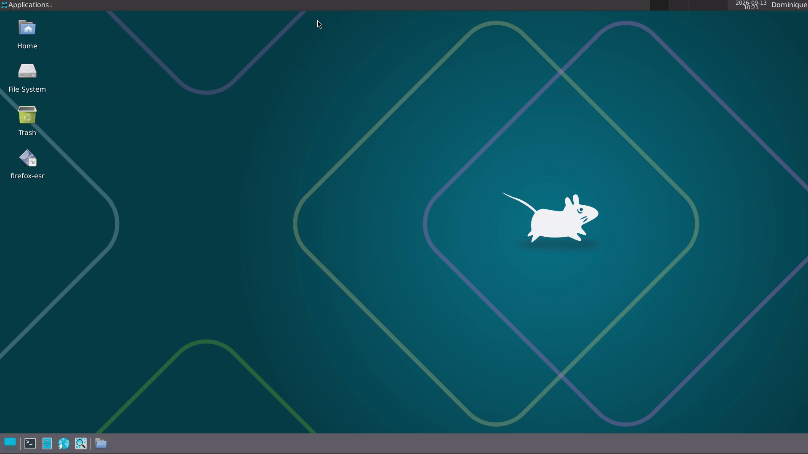
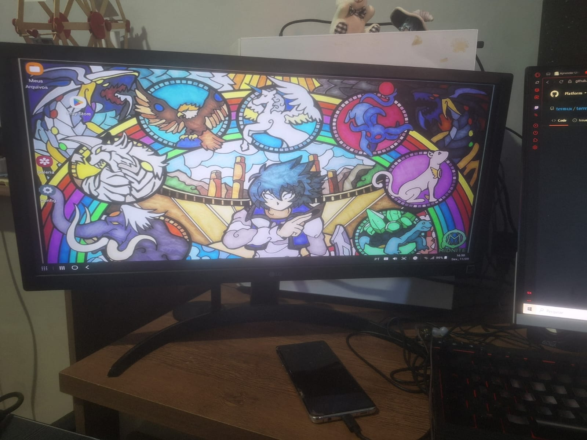

# Linudex

[English](README.md)

Linudex é um projeto de reaproveitamento que transforma um Samsung Galaxy S10+ com a tela danificada em um ambiente desktop ARM compacto. A pilha atual preserva o Samsung DeX e o Android como camada de hardware/drivers, enquanto Termux, PRoot-Distro, Debian e XFCE fornecem o ambiente desktop Linux.

## v0.1.0 — Linux Desktop Boot

A versão `v0.1.0` marca o primeiro estágio gráfico estável do Linux. Neste ponto, o Linudex consegue iniciar o Debian 13 ARM64 com XFCE através do Termux:X11 e permanecer estável nas cargas de desktop testadas.

## v0.2.0 — Ambiente Daily Driver

A versão `v0.2.0` parte do desktop Linux estável estabelecido na v0.1.0 e o transforma em um ambiente mais prático para uso diário. Áudio, armazenamento compartilhado, ajustes do desktop, aplicativos essenciais e automação de inicialização agora fazem parte do fluxo do Linudex.

## v0.2.1 — Correção da Inicialização Automática

A versão `v0.2.1` é uma atualização que corrige um bug da inicialização automática do Linudex causado por um erro ao tentar rodar o PulseAudio durante um cold boot.

## v0.3.0 — Compatibilidade experimental x86/x86-64

A versão `v0.3.0` acrescenta caminhos opcionais para executar programas Linux e Windows x86-64 com Box64, Wine, WineD3D e VirGL/ANGLE. Xonotic e Seraph's Last Stand abriram no ambiente testado, mas cargas 3D exigentes permaneceram lentas e alguns jogos não funcionaram. A camada de compatibilidade é experimental; o desktop Debian/XFCE da v0.2.1 continua sendo a base estável.

## v0.4.0 — Integração física de hardware

A v0.4.0 reúne o Galaxy S10+, um hub USB-C 8 em 1 e dois fans de 80 mm em um gabinete Nano. Foram integrados cabos HDMI, USB-C e P2, além de um kit de teclado e mouse sem fio. A saída HDMI já foi testada com um monitor do PC, sem necessidade de monitor dedicado nesta etapa.

Os dois fans funcionam como **exaustores** e foram testados em conjunto. Durante reproduções de YouTube 1080p, as temperaturas informadas foram **35,2 °C com os fans ligados** e **40,2 °C com eles desligados**, uma diferença observada de 5,0 °C. Os testes são preliminares e não medem temperatura do SoC. A verificação instrumental de tensão e polaridade da alimentação de refrigeração permanece pendente.

<!-- IMAGEM FUTURA: fotografia da montagem final em images/build/v0.4-final-build.png, quando realmente adicionada ao repositório. -->

### Concluído

- Armazenamento compartilhado do Android integrado ao Debian.
- Ponte PulseAudio configurada entre aplicativos Debian, Termux e Android/DeX.
- XFCE ajustado para uso em 1920×1080, com DPI 115 e compositor desativado.
- Painel do desktop, Whisker Menu e atalhos de aplicativos configurados.
- Aplicativos essenciais instalados e validados, incluindo Firefox ESR, LibreOffice, VLC, Evince e utilitários de compactação.
- Fontes compatíveis com documentos Office e suporte a idioma/correção ortográfica em português do Brasil instalados.
- `start-linudex.sh` e `stop-linudex.sh` ampliados para gerenciar áudio, Termux:X11 e a sessão Debian/XFCE.
- Termux:Boot configurado para iniciar o Linudex automaticamente após o boot do Android.
- Termux:Widget configurado para controle manual de start/stop quando necessário.
- Termux:X11 configurado para abrir automaticamente quando o Linudex é iniciado.
- Testada a execução de software Linux x86-64 com Box64 e a ponte gráfica OpenGL.
- Testada a execução de software Windows x86-64 com Wine 9.18-staging e WineD3D 9.2.
- Validado o DepotDownloader 3.4.0 ARM64 como alternativa ao SteamWebHelper para baixar arquivos autorizados pela conta.
- Documentados desempenho gráfico, limitações de memória e testes de compatibilidade malsucedidos.
- Mantidos os launchers de compatibilidade separados da inicialização automática existente do XFCE.
- Integrados gabinete, hub, conexões de vídeo e áudio externo, e dois fans de 80 mm, com teste térmico preliminar da v0.4.0.

## Arquitetura

```text
Samsung Galaxy S10+
└── Android 12 / One UI 4.1
    ├── Samsung DeX
    ├── Termux:Boot / Termux:Widget
    └── Termux
        ├── PulseAudio
        ├── Termux:X11
        └── PRoot-Distro
            └── Debian 13 ARM64
                └── XFCE
```

Esse desenho mantém o Android intencionalmente, pois ele fornece suporte ao hardware do Galaxy S10+, incluindo saída de vídeo USB-C, roteamento de áudio e Samsung DeX. O Debian roda como um ambiente de userspace sobre o kernel do Android, e não como uma máquina virtual.

Os caminhos de compatibilidade x86-64 utilizam Box64 e uma ponte gráfica opcional, além da arquitetura desktop apresentada acima. A v0.4.0 adiciona uma organização física para os componentes sem substituir a pilha de software. Consulte [Arquitetura](docs/architecture.pt.md) para os diagramas de conexões, alimentação e fluxo de ar.

## Estado atual

O ambiente para uso diário estabelecido na v0.2.1 permanece como base estável. A v0.3.0 acrescenta uma camada experimental de compatibilidade x86/x86-64; seus resultados de jogos são limitados e estão documentados, sem promessa de desempenho adequado.

A v0.4.0 dispõe de gabinete, hub, vídeo, extensão de áudio e refrigeração ativa em funcionamento na montagem testada. O monitor dedicado ainda não foi adquirido, mas o HDMI foi validado com uma tela existente. A alimentação dos fans funcionou nos testes práticos, porém a confirmação instrumental do perfil de 12 V, polaridade e corrente continua pendente; o carregador apresentou chiado discreto em algumas condições de baixa carga. Os dados térmicos devem ser interpretados como comparações preliminares.

<p align="center">
  
</p>

## Documentação

- [Baseline do sistema](docs/baseline.pt.md)
- [Arquitetura](docs/architecture.pt.md)
- [Debloat do Android](docs/debloat.pt.md)
- [Configuração de software](docs/software.pt.md)
- [Hardware](docs/hardware.pt.md)
- [Benchmarks](docs/benchmarks.pt.md)
- [Troubleshooting](docs/troubleshooting/README.pt.md)
- [Lista de materiais](bom/components.pt.md)

## Estrutura do repositório

```text
linudex/
├── README.md
├── README.pt.md
├── docs/
│   ├── architecture.md
│   ├── baseline.md
│   ├── benchmarks.md
│   ├── debloat.md
│   ├── hardware.md
│   ├── software.md
│   └── troubleshooting/
│       ├── README.md
│       ├── troubleshooting-v0.1.0.md
│       ├── troubleshooting-v0.2.0.md
│       ├── troubleshooting-v0.2.1.md
│       ├── troubleshooting-v0.3.0.md
│       └── troubleshooting-v0.4.0.md
├── images/
│   ├── benchmarks/
│   ├── build/
│   └── screenshots/
├── scripts/
├── configs/
└── bom/
```

Todo documento Markdown possui uma contraparte em português usando o sufixo `*.pt.md`.

## Organização das imagens

Use as pastas de imagens conforme a finalidade:

- `images/build/` — progresso da montagem física, gabinete, hub e refrigeração.
- `images/screenshots/` — capturas do DeX, Termux, Debian e XFCE.
- `images/benchmarks/` — capturas e gráficos dos benchmarks.

Evite colocar capturas diretamente em `docs/`; a documentação deve referenciar o arquivo correspondente dentro de `images/`.

## Escopo do projeto

Linudex é um projeto experimental de reaproveitamento. O objetivo não é substituir um PC x86 convencional em todas as cargas de trabalho, mas avaliar até onde um smartphone flagship danificado, porém funcional, pode ser reaproveitado como desktop ARM de baixo custo.

<p align="center">
  
</p>

## Licença

Este projeto é um software livre: você pode redistribuí-lo e/ou modificá-lo sob os termos da Licença Pública Geral GNU (GNU GPL) conforme publicada pela Free Software Foundation, seja a versão 3 da Licença, ou qualquer versão posterior.

Os diagramas, imagens e documentação textual contidos neste repositório também estão protegidos sob os mesmos termos da GNU GPL v3.
