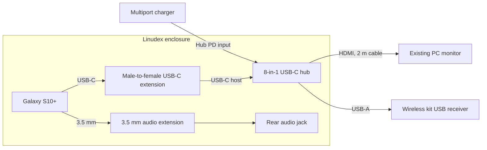
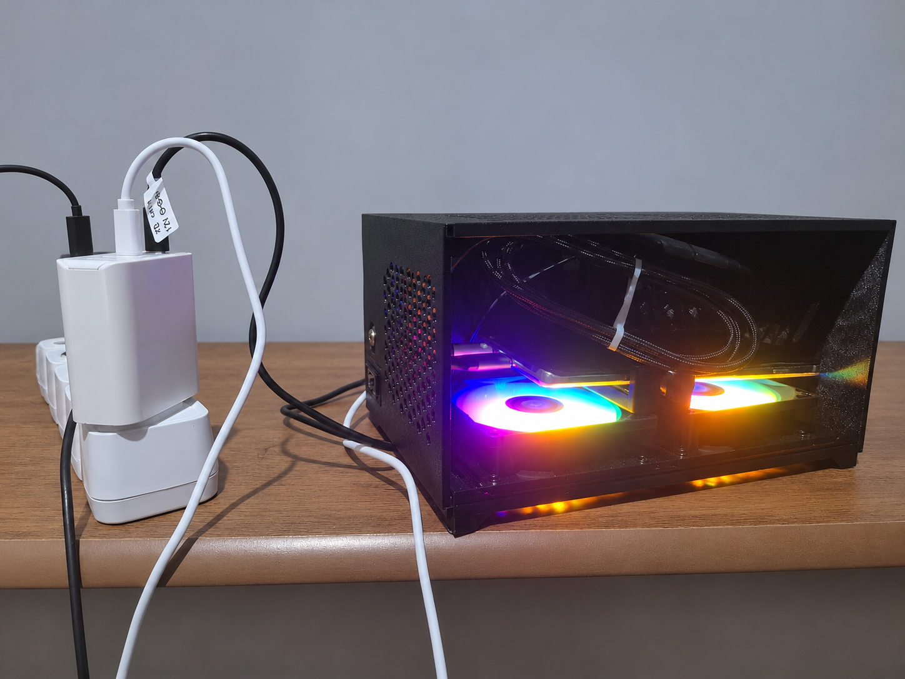
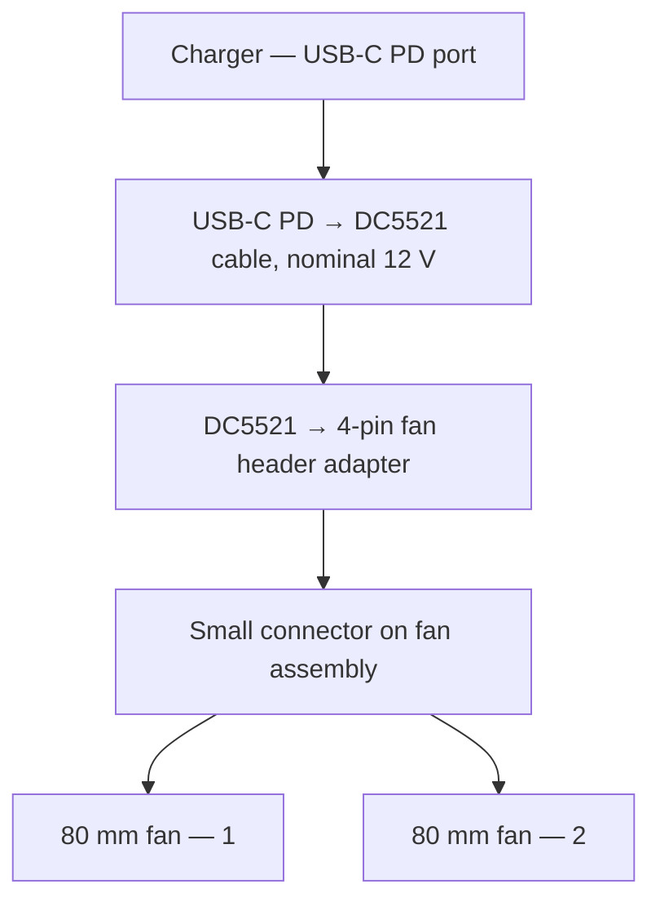
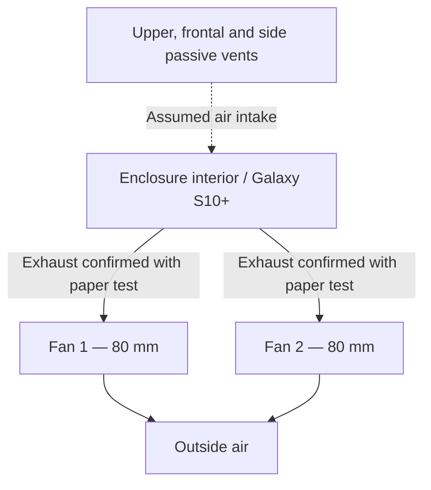

# Architecture

[Português](architecture.pt.md)

## Overview

Linudex uses Android as the hardware compatibility layer and runs a Debian ARM64 userspace on top of it. It is not a traditional virtual machine and it does not replace the Android kernel.

```text
External display / keyboard / mouse
                │
                ▼
        Samsung Galaxy S10+
                │
       Android 12 / One UI
        ┌───────┴──────────────┐
        │                      │
   Samsung DeX              Termux
                               │
              ┌────────────────┼────────────────┐
              │                │                │
         PulseAudio       Termux:X11       PRoot-Distro
              │                                  │
        Android audio                         Debian 13
                                                 │
                                               XFCE
```

Termux:Boot and Termux:Widget provide automatic and manual control of this stack but do not replace any of the runtime layers shown above.

## Layer responsibilities

### Android / One UI

Provides the Linux kernel, Samsung hardware drivers, networking, USB, audio stack, power management and the underlying display pipeline.

### Samsung DeX

Provides the Android desktop environment and reliable external-display support over USB-C. DeX is intentionally preserved during debloating because it remains part of the host environment even when the Linux desktop is running.

### Termux

Provides the command-line environment used to install and launch PRoot-Distro, PulseAudio and Termux:X11.

### PulseAudio

Runs on the Termux side as an audio bridge. Debian applications connect to the local PulseAudio server through `tcp:127.0.0.1`, allowing Linux application audio to reach Android/DeX.

### PRoot-Distro

Provides the Debian root filesystem and userspace without requiring Android root privileges. Because PRoot shares the Android kernel, some low-level Linux facilities and hardware metrics are not available exactly as they would be on a native Debian installation.

### Debian 13 ARM64

Provides the GNU/Linux userspace, package manager and desktop applications. The installation is named `linudex` in PRoot-Distro.

### Termux:X11

Provides the X11 display server that bridges Linux graphical applications to Android.

### XFCE

Provides the lightweight graphical desktop used by the v0.2.0 daily-driver environment.

### Termux:Boot and Termux:Widget

Termux:Boot launches the Linudex startup script after Android has completed booting. Termux:Widget provides manual start and stop shortcuts for cases where the Linux environment needs to be controlled from Android/DeX.

## Data and control paths

The graphical path is:

```text
XFCE / Linux applications
          │
          ▼
      Termux:X11
          │
          ▼
   Android display stack
          │
          ▼
     Samsung DeX
```

The audio path is:

```text
Debian application
       │
       ▼
PulseAudio client
       │
       ▼
tcp:127.0.0.1
       │
       ▼
Termux PulseAudio
       │
       ▼
 Android / DeX audio
```

Android shared storage is also exposed to the Debian environment for normal file exchange between both sides of the system.

## Why this architecture

The Galaxy S10+ already has mature Android drivers for its Exynos platform, USB-C display output and peripherals. Keeping Android avoids the incomplete hardware support currently associated with native Linux ports for this device while still allowing a conventional Debian userspace.

## Important limitations

- Debian does not own the kernel; it shares Android's kernel.
- PRoot is not a VM and does not provide hardware virtualization.
- Some `/proc` metrics are restricted by Android SELinux, which is why CPU data is collected through ADB rather than `htop` inside Debian.
- Traditional `systemd`, kernel module management and container workloads such as standard Docker are outside the current v0.2.0 scope.
- Android process-management policies can terminate the PRoot process tree unless the Phantom Process Killer behavior is mitigated.
- The current Phantom Process Killer workaround used by the project is still temporary across device reboots.

## Experimental x86/x86-64 compatibility — v0.3.0

Version v0.3.0 adds a separate compatibility path to the established Debian ARM64 desktop. The Android, Termux, PRoot-Distro, Termux:X11 and XFCE layers described above remain unchanged. The compatibility components are started on demand and do not replace the native ARM64 environment.

### Linux x86-64 applications

```text
Linux x86-64 application
          │
          ▼
        Box64
          │
          ▼
    Debian 13 ARM64
          │
          ▼
     Mesa virpipe
          │
          ▼
         VirGL
          │
          ▼
    ANGLE / Vulkan
          │
          ▼
 Android Vulkan / Mali-G76
```

Box64 translates x86-64 userspace instructions to ARM64; it does not emulate a complete PC. Linux x86-64 tests used the manually compiled Box64 0.4.5 build through the local `~/run-x86_64.sh` wrapper. The `~/start-linux-gpu.sh` helper on Termux selects the OpenGL profile (`vgl cfg=gl` and `vgl angle=vulkan`).

### Windows x86-64 applications

```text
Windows x86-64 executable
          │
          ▼
      Box64 0.3.4
          │
          ▼
    Wine 9.18-staging
          │
          ▼
      WineD3D 9.2
          │
          ▼
    Mesa / VirGL
          │
          ▼
    ANGLE / Vulkan
          │
          ▼
 Android Vulkan / Mali-G76
```

The tested Windows path uses `/usr/bin/box64`, the local `~/xow64` launcher and the `.xow64_test` Wine prefix. WineD3D translates Direct3D calls to OpenGL. The Termux `~/start-wine-gpu.sh` helper selects `vgl cfg=d3d` and `vgl angle=vulkan-null`; the latter is the profile name used by the tested configuration, not a claim of direct Windows Vulkan support.

### Component versions

| Component            | Version / configuration             | Role                                              |
| -------------------- | ----------------------------------- | ------------------------------------------------- |
| Box64 for Wine       | 0.3.4                               | x86-64 translation for the working Wine baseline  |
| Box64 for Linux      | Manual 0.4.5 build                  | Linux x86-64 execution experiments                |
| Wine                 | 9.18-staging                        | Windows API compatibility                         |
| WineD3D              | 9.2                                 | Direct3D-to-OpenGL translation                    |
| Mesa / VirGL / ANGLE | Virtual GPU / Android Vulkan bridge | Graphics translation                              |
| DepotDownloader      | 3.4.0 ARM64                         | Download authorized Steam depots without Steam UI |

### Limitations

- The virtual renderer can appear as `Red Hat VirtIO GPU` rather than Mali-G76. Graphics features exposed to applications can be more limited than those supported by the physical GPU.
- Multiple translation layers introduce considerable overhead. A game opening successfully does not imply playable performance.
- The complete Windows Steam client caused substantial memory pressure from SteamWebHelper. DepotDownloader avoids running that interface, but does not bypass Steamworks, DRM or licensing requirements.
- `9 Kings` initialized Direct3D 11 at feature level 10_1 and reported unsupported shaders. Forcing OpenGL 4.1 failed to initialize Unity graphics. This does not establish a hardware limitation of the Mali-G76.
- Do not use the experimental `~/xow64 q` shutdown command: it can terminate unrelated desktop processes. Use the validated, prefix-scoped `~/stop-xow64-wine.sh` helper instead.
- A complete installation of the v0.3.0 compatibility stack from a clean device has not yet been validated. The scripts used during testing must be reviewed before publication.

See [Software Setup](software.md), [Benchmarks](benchmarks.md) and [Troubleshooting](troubleshooting/README.md) for the respective setup, results and known problems.

## Physical integration — v0.4.0

Version v0.4.0 adds a compact enclosure, USB-C hub and active cooling to the existing build. It does not replace the software stack described above. The following diagrams describe **physical connections**, not the Android/Debian software architecture.

### Device connections



The hub receives power through its PD input. HDMI operation was confirmed with an existing PC monitor; a dedicated display is not required to complete the v0.4.0 physical integration. The hub's additional interfaces, including Ethernet, SD, TF/microSD and USB-C data, remain accessible but are not shown as active connections.



### Fan power supply

The working connection uses a nominal 12 V USB-C-to-DC5521 cable and the **small fan connector** on the cooling assembly. The adapter is sold as DC5521 to 4-pin PWM. The fans' large peripheral Molex connectors are not used in this path.



**Validation note:** The charger's 12 V profile and the PD trigger output still require instrumented confirmation. Do not feed power through the large Molex connectors and the small fan connector at the same time.

### Airflow



Both fans expel air out of the enclosure, as verified with a paper strip on the inside and outside. Passive air intake through the other openings is plausible, but its precise path was not measured: the paper showed no noticeable movement at those vents. See [Hardware](hardware.md) and [Benchmarks](benchmarks.md) for test details.
