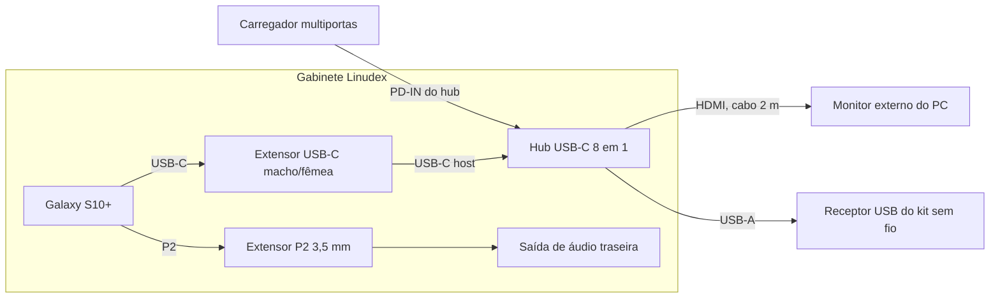
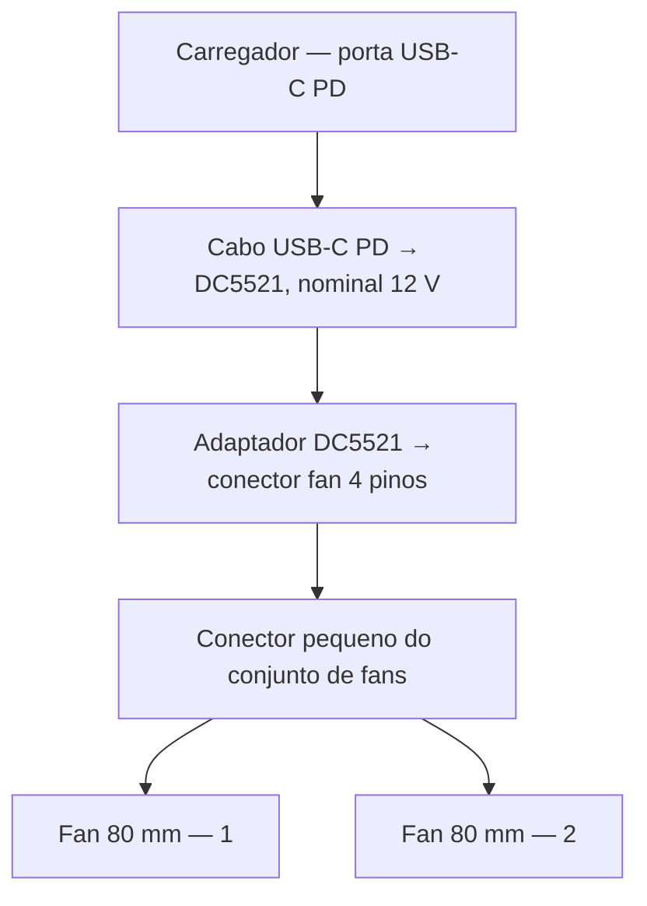
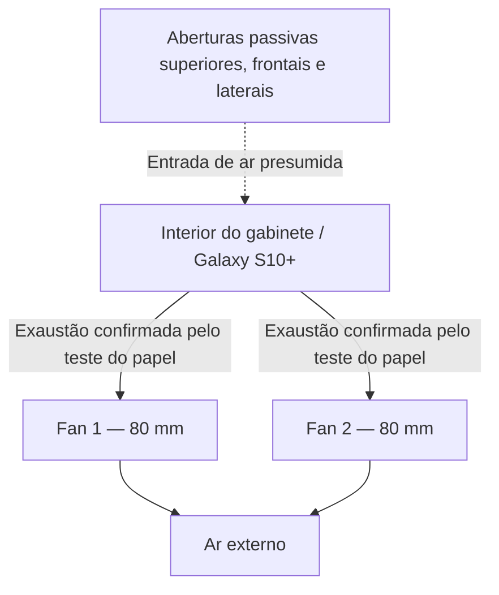

# Arquitetura

[English](architecture.md)

## Visão geral

O Linudex usa o Android como camada de compatibilidade com o hardware e executa um userspace Debian ARM64 sobre ele. Não é uma máquina virtual tradicional e não substitui o kernel do Android.

```text
Monitor externo / teclado / mouse
                │
                ▼
        Samsung Galaxy S10+
                │
       Android 12 / One UI
        ┌───────┴──────────────┐
        │                      │
   Samsung DeX              Termux
                               │
              ┌────────────────┼────────────────┐
              │                │                │
         PulseAudio       Termux:X11       PRoot-Distro
              │                                  │
        Áudio Android                          Debian 13
                                                 │
                                               XFCE
```

Termux:Boot e Termux:Widget fornecem controle automático e manual dessa pilha, mas não substituem nenhuma das camadas de execução mostradas acima.

## Responsabilidade de cada camada

### Android / One UI

Fornece o kernel Linux, drivers Samsung, rede, USB, pilha de áudio, gerenciamento de energia e a infraestrutura de vídeo subjacente.

### Samsung DeX

Fornece o ambiente desktop Android e suporte confiável ao monitor externo via USB-C. O DeX é preservado intencionalmente durante o debloat porque continua fazendo parte do host mesmo quando o desktop Linux está em execução.

### Termux

Fornece o ambiente de linha de comando utilizado para instalar e iniciar PRoot-Distro, PulseAudio e Termux:X11.

### PulseAudio

Executa no lado do Termux como ponte de áudio. Os aplicativos Debian se conectam ao servidor PulseAudio local através de `tcp:127.0.0.1`, permitindo que o áudio dos aplicativos Linux chegue ao Android/DeX.

### PRoot-Distro

Fornece o filesystem raiz e o userspace do Debian sem exigir root no Android. Como o PRoot compartilha o kernel do Android, alguns recursos Linux de baixo nível e métricas de hardware não ficam disponíveis exatamente como ficariam em uma instalação Debian nativa.

### Debian 13 ARM64

Fornece o userspace GNU/Linux, gerenciador de pacotes e aplicativos desktop. A instalação recebe o nome `linudex` no PRoot-Distro.

### Termux:X11

Fornece o servidor X11 que conecta os aplicativos gráficos Linux ao Android.

### XFCE

Fornece o desktop gráfico leve utilizado pelo ambiente Daily Driver da v0.2.0.

### Termux:Boot e Termux:Widget

O Termux:Boot executa o script de inicialização do Linudex depois que o Android conclui o boot. O Termux:Widget fornece atalhos manuais de start e stop para situações em que o ambiente Linux precisa ser controlado a partir do Android/DeX.

## Fluxos de dados e controle

O caminho gráfico é:

```text
XFCE / aplicativos Linux
          │
          ▼
      Termux:X11
          │
          ▼
  Pilha gráfica Android
          │
          ▼
     Samsung DeX
```

O caminho de áudio é:

```text
Aplicativo Debian
       │
       ▼
Cliente PulseAudio
       │
       ▼
tcp:127.0.0.1
       │
       ▼
PulseAudio no Termux
       │
       ▼
 Áudio Android / DeX
```

O armazenamento compartilhado do Android também é exposto ao ambiente Debian para permitir troca normal de arquivos entre os dois lados do sistema.

## Por que esta arquitetura

O Galaxy S10+ já possui drivers Android maduros para a plataforma Exynos, saída de vídeo USB-C e periféricos. Manter o Android evita o suporte incompleto de hardware dos ports Linux nativos atualmente disponíveis para esse aparelho, ao mesmo tempo em que permite utilizar um userspace Debian convencional.

## Limitações importantes

- O Debian não controla o kernel; ele compartilha o kernel do Android.
- PRoot não é uma VM e não fornece virtualização de hardware.
- Algumas métricas de `/proc` são restringidas pelo SELinux do Android; por isso a CPU é medida via ADB, e não pelo `htop` dentro do Debian.
- `systemd` tradicional, gerenciamento de módulos do kernel e workloads como Docker padrão estão fora do escopo atual da v0.2.0.
- Políticas de gerenciamento de processos do Android podem encerrar a árvore de processos do PRoot caso o Phantom Process Killer não seja mitigado.
- O workaround atual do projeto para o Phantom Process Killer ainda é temporário entre reinicializações do aparelho.

## Compatibilidade experimental x86/x86-64 — v0.3.0

A versão v0.3.0 adiciona uma camada de compatibilidade ao desktop Debian ARM64 já estabelecido. As camadas Android, Termux, PRoot-Distro, Termux:X11 e XFCE descritas anteriormente permanecem inalteradas. Os componentes de compatibilidade são iniciados sob demanda e não substituem o ambiente ARM64 nativo.

### Aplicativos Linux x86-64

```text
Aplicativo Linux x86-64
          │
          ▼
        Box64
          │
          ▼
    Debian 13 ARM64
          │
          ▼
     Mesa virpipe
          │
          ▼
         VirGL
          │
          ▼
    ANGLE / Vulkan
          │
          ▼
 Vulkan Android / Mali-G76
```

O Box64 traduz instruções de programas x86-64 para ARM64; ele não emula um computador completo. Os testes Linux x86-64 utilizaram o Box64 0.4.5 compilado manualmente, por meio do wrapper local `~/run-x86_64.sh`. No Termux, o auxiliar `~/start-linux-gpu.sh` seleciona o perfil OpenGL (`vgl cfg=gl` e `vgl angle=vulkan`).

### Aplicativos Windows x86-64

```text
Executável Windows x86-64
          │
          ▼
      Box64 0.3.4
          │
          ▼
    Wine 9.18-staging
          │
          ▼
      WineD3D 9.2
          │
          ▼
    Mesa / VirGL
          │
          ▼
    ANGLE / Vulkan
          │
          ▼
 Vulkan Android / Mali-G76
```

O caminho Windows testado usa `/usr/bin/box64`, o lançador local `~/xow64` e o prefixo Wine `.xow64_test`. O WineD3D traduz chamadas Direct3D para OpenGL. No Termux, o auxiliar `~/start-wine-gpu.sh` seleciona `vgl cfg=d3d` e `vgl angle=vulkan-null`; este último é o nome do perfil usado na configuração testada, não uma indicação de suporte direto ao Vulkan de Windows.

### Versões dos componentes

| Componente           | Versão / configuração                 | Função                                                   |
| -------------------- | ------------------------------------- | -------------------------------------------------------- |
| Box64 para Wine      | 0.3.4                                 | Tradução x86-64 da configuração funcional do Wine        |
| Box64 para Linux     | Build manual 0.4.5                    | Testes de execução Linux x86-64                          |
| Wine                 | 9.18-staging                          | Compatibilidade com APIs Windows                         |
| WineD3D              | 9.2                                   | Tradução Direct3D para OpenGL                            |
| Mesa / VirGL / ANGLE | GPU virtual / ponte Vulkan do Android | Tradução gráfica                                         |
| DepotDownloader      | 3.4.0 ARM64                           | Download de depots Steam autorizados sem interface Steam |

### Limitações

- O renderizador virtual pode ser identificado como `Red Hat VirtIO GPU`, em vez da Mali-G76. Os recursos gráficos apresentados aos programas podem ser inferiores aos da GPU física.
- As várias camadas de tradução introduzem sobrecarga significativa. Conseguir abrir um jogo não significa obter desempenho adequado.
- O cliente Steam Windows completo produziu alto consumo de memória pelo SteamWebHelper. O DepotDownloader evita manter essa interface em execução, mas não contorna exigências do Steamworks, DRM ou licenciamento.
- O `9 Kings` inicializou Direct3D 11 com feature level 10_1 e apresentou erros de shaders. Ao forçar OpenGL 4.1, a inicialização gráfica da Unity falhou. Isso não comprova uma limitação física da Mali-G76.
- Não utilize o comando experimental `~/xow64 q` para encerrar o Wine: ele pode finalizar processos não relacionados do desktop. Utilize o auxiliar validado `~/stop-xow64-wine.sh`, restrito ao prefixo.
- Uma instalação completa da camada de compatibilidade v0.3.0 em um aparelho limpo ainda não foi validada. Os scripts utilizados nos testes precisam ser revisados antes da publicação.

Consulte [Configuração de software](software.pt.md), [Benchmarks](benchmarks.pt.md) e [Troubleshooting](troubleshooting/README.pt.md) para instalação, resultados e problemas conhecidos.

## Integração física — v0.4.0

A v0.4.0 acrescenta um gabinete compacto, um hub USB-C e refrigeração ativa à configuração existente. A pilha de software descrita acima não é substituída. O objetivo do diagrama é representar as **conexões físicas**, não os caminhos lógicos entre Android e Debian.

### Conexões do conjunto



A porta PD-IN do hub recebe alimentação do carregador. O HDMI já foi testado com um monitor do PC, sem que seja necessário adquirir um monitor exclusivo para fechar a v0.4.0. As demais portas do hub, como Ethernet, SD, TF/microSD e USB-C de dados, permanecem acessíveis, mas não devem ser confundidas com conexões em uso no diagrama.

<!-- IMAGEM FUTURA: foto do conjunto montado e painel traseiro. Pasta images/build/. -->

### Alimentação dos fans

O caminho efetivamente utilizado conecta o cabo USB-C/12 V ao adaptador DC5521 e, em seguida, ao **conector pequeno de fan** do conjunto de coolers. O anúncio do adaptador descreve uma saída de 4 pinos PWM; os conectores Molex periféricos grandes dos fans não foram usados nesse caminho.



**Observação de validação:** O perfil de 12 V do carregador e do cabo trigger ainda precisa ser verificado com instrumento apropriado. Não se deve ligar o conector Molex grande e o conector pequeno à alimentação simultaneamente.

### Fluxo de ar



Os dois fans expulsam ar para fora do gabinete, conforme teste com papel realizado pelos lados interno e externo. A presença de múltiplas grades torna plausível a entrada passiva de ar, mas o caminho exato não foi medido: o papel não apresentou deslocamento perceptível nessas grades. Ver [Hardware](hardware.pt.md) e [Benchmarks](benchmarks.pt.md) para detalhes dos testes.

<!-- IMAGEM FUTURA: posicionamento dos dois fans e passagem de cabos (images/build/). -->
