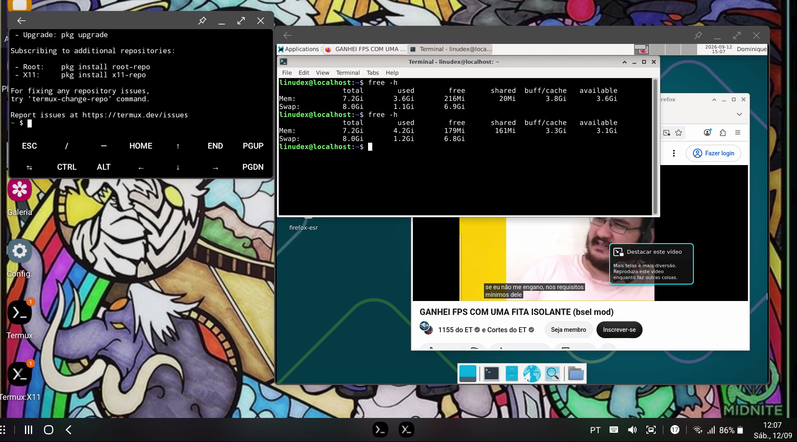
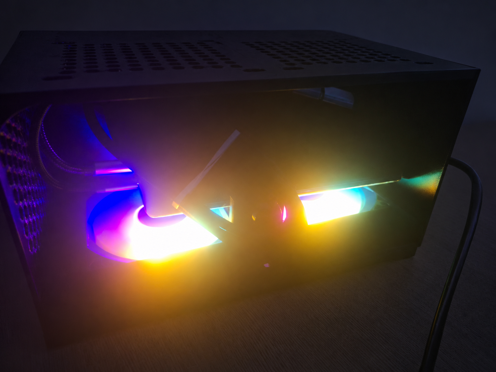

# Benchmarks

[Português](benchmarks.pt.md)

Initial v0.1 validation focused on practical desktop workloads rather than synthetic benchmark scores.

## Method

- Debian 13 ARM64 running through PRoot-Distro.
- XFCE rendered through Termux:X11.
- CPU usage collected from Android through ADB (`dumpsys cpuinfo`) because Android SELinux restrictions prevent reliable global CPU readings from `htop` inside PRoot.
- RAM collected from Debian with `free -h`.
- Battery temperature collected through ADB (`dumpsys battery`).
- Each workload was allowed to settle before values were recorded.

The battery temperature is not the SoC temperature.

## Results

| Test                         | RAM used | RAM available | CPU total | CPU breakdown           | Battery temp. | Stability |
| ---------------------------- | -------: | ------------: | --------: | ----------------------- | ------------: | --------- |
| XFCE idle                    |  3.4 GiB |       3.8 GiB |       10% | 4.9% user + 5.9% kernel |       27.8 °C | Stable    |
| XFCE + Firefox               |  3.4 GiB |       3.9 GiB |       13% | 6.0% user + 7.2% kernel |       29.8 °C | Stable    |
| Firefox + 5 tabs             |  3.4 GiB |       3.8 GiB |       16% | 7.5% user + 8.3% kernel |       30.7 °C | Stable    |
| YouTube 1440p in Firefox ESR |  4.2 GiB |       3.1 GiB |       62% | 40% user + 22% kernel   |       33.0 °C | Stable    |

Total RAM reported during these tests was approximately 7.2 GiB.



## Observations

- All recorded v0.1 workloads remained stable.
- YouTube 1440p was the heaviest tested workload and produced the largest increase in both CPU usage and RAM consumption.
- The battery temperature remained at 33.0 °C during the 1440p test.
- The results validate the software stack as a usable proof of concept, but they do not yet measure SoC temperature, hardware video-decoding efficiency or long-duration thermal throttling.
- After increasing the Android 12 phantom-process limit, the previous random `SIGKILL` (`signal 9`) terminations were no longer observed during these tests.

## Metrics to preserve for future tests

For consistent comparisons, record at minimum:

```text
CPU total: XX%
RAM used: X.X GiB
RAM available: X.X GiB
Battery temperature: XX.X °C
Stability: Stable / Unstable
```

Use the final `XX% TOTAL` line from `adb shell dumpsys cpuinfo` for CPU and the `temperature:` field from `adb shell dumpsys battery`, divided by 10, for battery temperature.

## v0.3.0 — x86-64 compatibility and graphics tests

Version v0.3.0 introduced Box64, WineD3D and VirGL/ANGLE graphics experiments. Results were measured on the Galaxy S10+ with Debian ARM64 through PRoot-Distro. These figures describe the specific tested configuration; they are not general performance claims for the physical Mali-G76 GPU.

### OpenGL benchmark — GLMark2

| Renderer / resolution    | Score | Notes                         |
| ------------------------ | ----: | ----------------------------- |
| VirGL/ANGLE at 1280×720  |    67 | OpenGL accelerated bridge     |
| VirGL/ANGLE at 1920×1080 |    40 | Higher output resolution      |
| llvmpipe at 1280×720     |    51 | Software rendering comparison |

The VirGL/ANGLE path improved the 720p score over the llvmpipe comparison but remained slow for demanding 3D workloads. Testing `vulkan-null` instead of `vulkan` did not improve the observed 720p score.

### Xonotic — Linux x86-64

Xonotic 0.8.6 ran through the manually compiled Box64 0.4.5 and the Linux OpenGL graphics profile. The timedemo used `demos/the-big-keybench.dem`, with VSync disabled and a 60 FPS cap.

| Metric                       | 1280×720 |    1920×1080 |
| ---------------------------- | -------: | -----------: |
| Timedemo overall average FPS |       14 | Not recorded |
| One-second minimum FPS       |       14 |            8 |
| One-second average FPS       |       17 |           11 |
| One-second maximum FPS       |       20 |           15 |
| Maximum battery temperature  |  32.3 °C |      28.3 °C |
| Typical Android total CPU    |     ~16% |         ~16% |
| Observed crashes             |        0 |            0 |

### Additional Xonotic test conditions

| Metric                      |                     1280×720 |                    1920×1080 |
| --------------------------- | ---------------------------: | ---------------------------: |
| Run duration                |                     1 minute |                     1 minute |
| Initial battery level       |                          84% |                          84% |
| Final battery level         |                          84% |                          84% |
| Initial battery temperature |                      28.2 °C |                      27.9 °C |
| Peak Android total CPU      | ~33% (17% user + 15% kernel) | ~29% (15% user + 14% kernel) |
| Typical CPU breakdown       |         ~7% user + 9% kernel |         ~7% user + 9% kernel |
| Available RAM before test   |                 ~3.1–3.2 GiB |                     ~3.8 GiB |
| Available RAM during test   |                 ~2.4–2.5 GiB |                     ~2.4 GiB |
| Rendering issues            |                            0 |                            0 |
| Audio issues                |                            0 |                            0 |

The one-second average is not interchangeable with the overall timedemo average. Approximately 2.4–2.5 GiB of available RAM was observed during the 720p run. No rendering or audio failures were reported in these runs. The battery readings are not SoC temperatures.

### Windows x86-64 games and Steam

| Test                    | Result                                                | Limitation                                                                     |
| ----------------------- | ----------------------------------------------------- | ------------------------------------------------------------------------------ |
| Seraph's Last Stand     | Started and played without Steam UI                   | Approximately 10 FPS by visual observation, not an instrumented benchmark      |
| 9 Kings                 | Unity 6 launched and initialized a Direct3D 11 device | Feature level 10_1, unsupported shaders and Steam launch behavior; no gameplay |
| Terraria (Linux x86-64) | Box64 launched the executable                         | Game required launch through the Steam client                                  |
| Windows Steam client    | Installed, updated and logged in                      | SteamWebHelper caused substantial memory pressure and very slow startup        |

For Seraph, the earlier Unity resolution parameters did not preserve the lower resolution during gameplay. The `GALLIUM_HUD=fps` attempt triggered a shader compilation failure and was therefore excluded from FPS measurements. The approximate gameplay FPS must not be presented as a measured average.

During a test without Steam running, available RAM decreased from approximately 3.7 GiB to 2.2 GiB while Seraph was running with Firefox open. Steam caused a substantially larger memory impact, so the full client was excluded from further game tests.

### Interpretation

- Application startup and playable performance are different criteria.
- The primary limitation observed in these tests was the multi-layer graphics path rather than a confirmed thermal bottleneck.
- Compatibility is experimental; no general claim of smooth Windows gaming is supported.
- The hardware enclosure, fans and final peripheral setup remain outside the v0.3.0 benchmark scope.

## Active cooling and thermal tests

The v0.4.0 build uses two 80 mm fans as **exhaust fans** at the bottom of the enclosure. Test durations were reported as approximately **20 minutes per configuration**, with fans on or off. Values below are individual reported readings, not time averages or CPU temperatures.

### Recorded temperatures

| Condition           | Fans on | Fans off | Observed difference |
| ------------------- | ------: | -------: | ------------------: |
| Initial state       | 32.1 °C |  33.6 °C |             −1.5 °C |
| Firefox open        | 32.4 °C |  34.2 °C |             −1.8 °C |
| Firefox with 8 tabs | 32.9 °C |  36,7 °C |             -3,8 °C |
| YouTube 1080p       | 35.2 °C |  40.2 °C |         **−5.0 °C** |

### Interpretation and limitations

- The largest observed gap was during YouTube 1080p playback: **5.0 °C lower with the fans on**.
- Initial temperatures differed, and ambient temperature, complete time series and tightly controlled test order were not recorded. The entire 5.0 °C difference therefore cannot be assigned to the fans alone.
- The test duration was 20 minutes per test. The available observations do not establish full thermal equilibrium in every run.
- Both fans operated and their exhaust direction was confirmed by a paper-strip test.
- FPS, SoC frequency, internal SoC temperature and instrumented thermal-throttling evidence were not collected in this set of tests.

These results provide **preliminary evidence of a thermal benefit in the current enclosure**, not a certification of cooling efficiency. Instrumented measurement of the USB-C PD trigger's nominal 12 V output and polarity remains pending.


