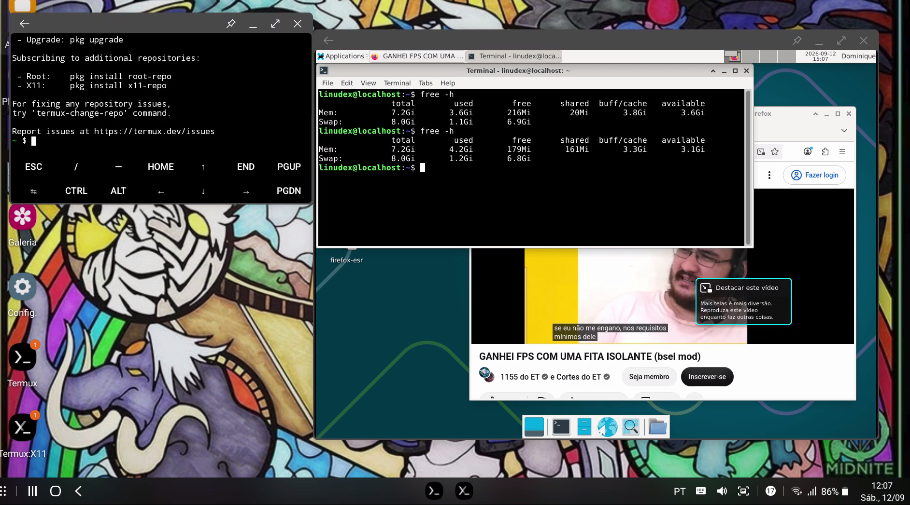

# Benchmarks

[English](benchmarks.md)

A validação inicial da v0.1 foi focada em cargas práticas de desktop, e não em pontuações de benchmarks sintéticos.

## Metodologia

- Debian 13 ARM64 executado através do PRoot-Distro.
- XFCE renderizado através do Termux:X11.
- Uso de CPU coletado pelo Android via ADB (`dumpsys cpuinfo`), pois as restrições do SELinux do Android impedem leituras globais confiáveis de CPU pelo `htop` dentro do PRoot.
- RAM coletada dentro do Debian com `free -h`.
- Temperatura da bateria coletada via ADB (`dumpsys battery`).
- Cada carga foi mantida tempo suficiente para estabilizar antes do registro dos valores.

A temperatura da bateria não corresponde à temperatura do SoC.

## Resultados

| Teste                        | RAM usada | RAM disponível | CPU total | Divisão da CPU          | Temp. bateria | Estabilidade |
| ---------------------------- | --------: | -------------: | --------: | ----------------------- | ------------: | ------------ |
| XFCE em idle                 |   3.4 GiB |        3.8 GiB |       10% | 4.9% user + 5.9% kernel |       27.8 °C | Estável      |
| XFCE + Firefox               |   3.4 GiB |        3.9 GiB |       13% | 6.0% user + 7.2% kernel |       29.8 °C | Estável      |
| Firefox + 5 abas             |   3.4 GiB |        3.8 GiB |       16% | 7.5% user + 8.3% kernel |       30.7 °C | Estável      |
| YouTube 1440p no Firefox ESR |   4.2 GiB |        3.1 GiB |       62% | 40% user + 22% kernel   |       33.0 °C | Estável      |

A RAM total reportada durante estes testes foi de aproximadamente 7.2 GiB.



## Observações

- Todas as cargas registradas na v0.1 permaneceram estáveis.
- YouTube em 1440p foi a carga mais pesada testada e produziu o maior aumento tanto no uso de CPU quanto no consumo de RAM.
- A temperatura da bateria permaneceu em 33.0 °C durante o teste de 1440p.
- Os resultados validam a pilha de software como prova de conceito utilizável, mas ainda não medem temperatura do SoC, eficiência da decodificação de vídeo por hardware ou throttling térmico de longa duração.
- Depois do aumento do limite de processos phantom do Android 12, os encerramentos aleatórios anteriores por `SIGKILL` (`signal 9`) deixaram de ser observados durante os testes.

## Métricas para preservar nos próximos testes

Para manter comparações consistentes, registre no mínimo:

```text
CPU total: XX%
RAM usada: X.X GiB
RAM disponível: X.X GiB
Temperatura da bateria: XX.X °C
Estabilidade: Estável / Instável
```

Para CPU, use a linha final `XX% TOTAL` de `adb shell dumpsys cpuinfo`. Para a temperatura da bateria, use o campo `temperature:` de `adb shell dumpsys battery` dividido por 10.

## v0.3.0 — Testes de compatibilidade x86-64 e gráficos

A v0.3.0 introduziu experimentos com Box64, WineD3D e a ponte gráfica VirGL/ANGLE. Os resultados foram obtidos no Galaxy S10+ com Debian ARM64 pelo PRoot-Distro. Esses números descrevem a configuração testada e não são uma medição geral da capacidade física da GPU Mali-G76.

### Benchmark OpenGL — GLMark2

| Renderizador / resolução | Pontuação | Observações |
| --- | ---: | --- |
| VirGL/ANGLE em 1280×720 | 67 | Ponte OpenGL acelerada |
| VirGL/ANGLE em 1920×1080 | 40 | Resolução de saída mais alta |
| llvmpipe em 1280×720 | 51 | Comparação por renderização em software |

O caminho VirGL/ANGLE superou o llvmpipe em 720p, mas permaneceu lento em cargas 3D exigentes. Testar `vulkan-null` no lugar de `vulkan` não melhorou a pontuação observada em 720p.

### Xonotic — Linux x86-64

O Xonotic 0.8.6 executou pelo Box64 0.4.5 compilado manualmente e pelo perfil gráfico Linux OpenGL. O timedemo utilizou `demos/the-big-keybench.dem`, com VSync desativado e limite de 60 FPS.

| Métrica | 1280×720 | 1920×1080 |
| --- | ---: | ---: |
| FPS médio geral do timedemo | 14 | Não registrado |
| FPS mínimo em janelas de 1 segundo | 14 | 8 |
| FPS médio em janelas de 1 segundo | 17 | 11 |
| FPS máximo em janelas de 1 segundo | 20 | 15 |
| Temperatura máxima da bateria | 32,3 °C | 28,3 °C |
| CPU total típica do Android | ~16% | ~16% |
| Travamentos observados | 0 | 0 |

### Condições adicionais dos testes do Xonotic

| Métrica | 1280×720 | 1920×1080 |
| --- | ---: | ---: |
| Duração | 1 minuto | 1 minuto |
| Bateria inicial | 84% | 84% |
| Bateria final | 84% | 84% |
| Temperatura inicial da bateria | 28,2 °C | 27,9 °C |
| Pico da CPU total do Android | ~33% (17% user + 15% kernel) | ~29% (15% user + 14% kernel) |
| Distribuição típica da CPU | ~7% user + 9% kernel | ~7% user + 9% kernel |
| RAM disponível antes | ~3,1–3,2 GiB | ~3,8 GiB |
| RAM disponível durante | ~2,4–2,5 GiB | ~2,4 GiB |
| Problemas gráficos | 0 | 0 |
| Problemas de áudio | 0 | 0 |

A média das janelas de um segundo não deve ser confundida com a média geral do timedemo. Durante o teste em 720p, foram observados aproximadamente 2,4–2,5 GiB de RAM disponível. Não foram relatados problemas de gráficos ou áudio nessas execuções. As temperaturas registradas correspondem à bateria, não ao SoC.

### Jogos Windows x86-64 e Steam

| Teste | Resultado | Limitação |
| --- | --- | --- |
| Seraph's Last Stand | Abriu e permitiu jogar sem manter a interface Steam aberta | Aproximadamente 10 FPS por observação visual, sem benchmark instrumentado |
| 9 Kings | Unity 6 iniciou e criou um dispositivo Direct3D 11 | Feature level 10_1, shaders sem suporte e comportamento de inicialização da Steam; sem chegar à partida |
| Terraria (Linux x86-64) | Box64 iniciou o executável | O jogo exigiu inicialização pelo cliente Steam |
| Cliente Steam Windows | Instalou, atualizou e autenticou | SteamWebHelper causou alto consumo de memória e inicialização muito lenta |

No Seraph, os parâmetros da Unity para reduzir resolução não permaneceram aplicados durante a partida. A tentativa de `GALLIUM_HUD=fps` provocou falha de compilação de shader e foi excluída das medições. O FPS aproximado observado visualmente não deve ser apresentado como média medida.

Em um teste sem Steam, a RAM disponível caiu de aproximadamente 3,7 GiB para 2,2 GiB durante a execução do Seraph com Firefox aberto. O cliente Steam apresentou impacto muito maior na memória e foi excluído dos testes seguintes.

### Interpretação

- Conseguir abrir um aplicativo e obter desempenho adequado são critérios diferentes.
- A principal limitação observada foi o caminho de tradução gráfica em várias camadas, e não um gargalo térmico confirmado.
- A compatibilidade permanece experimental; os testes não sustentam uma afirmação geral de jogos Windows fluidos.
- O gabinete físico, os coolers e os periféricos definitivos permanecem fora do escopo dos benchmarks da v0.3.0.
