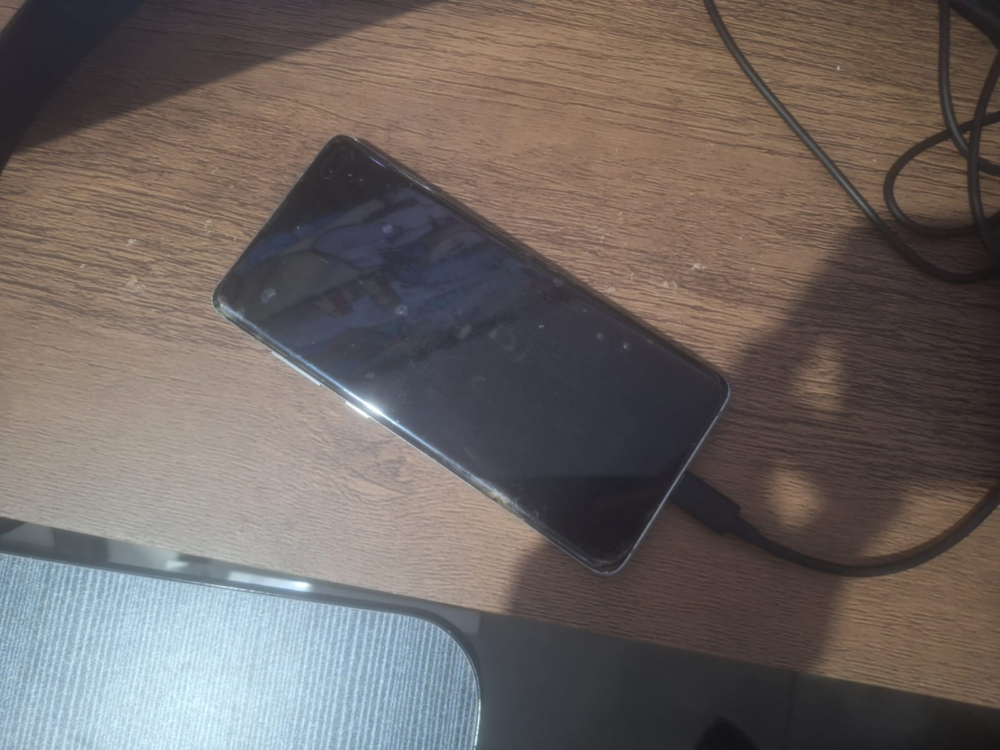
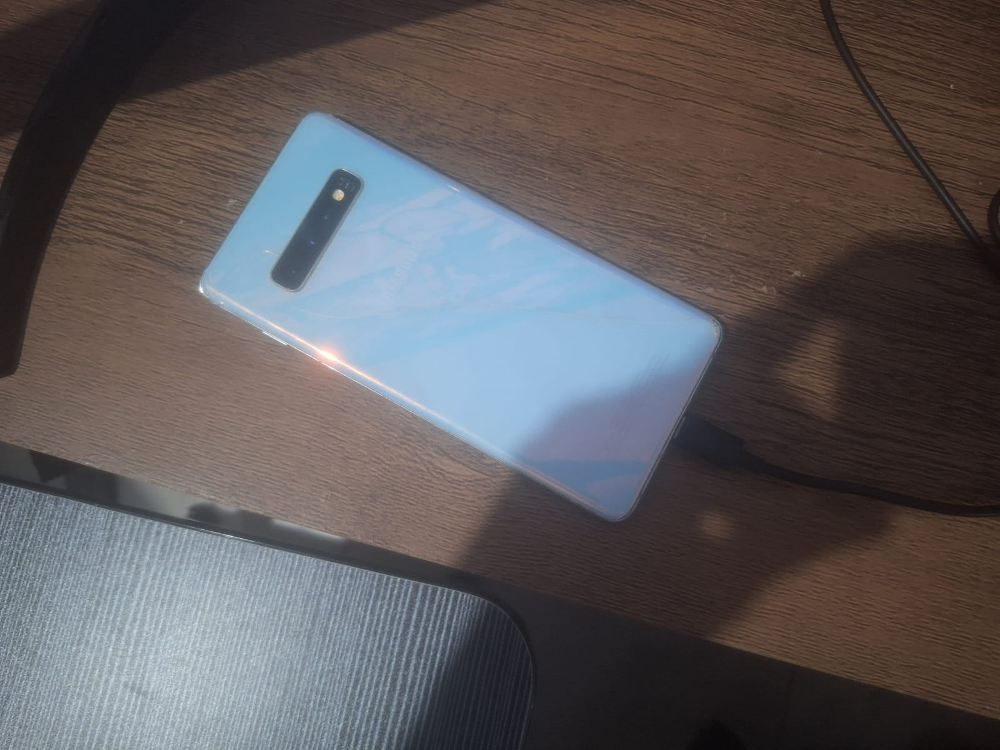
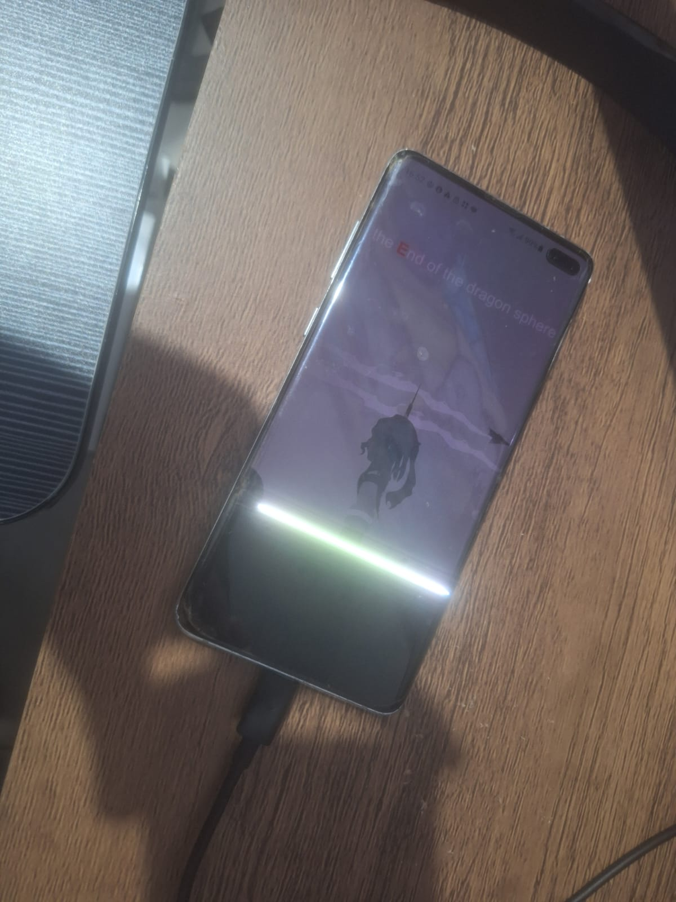
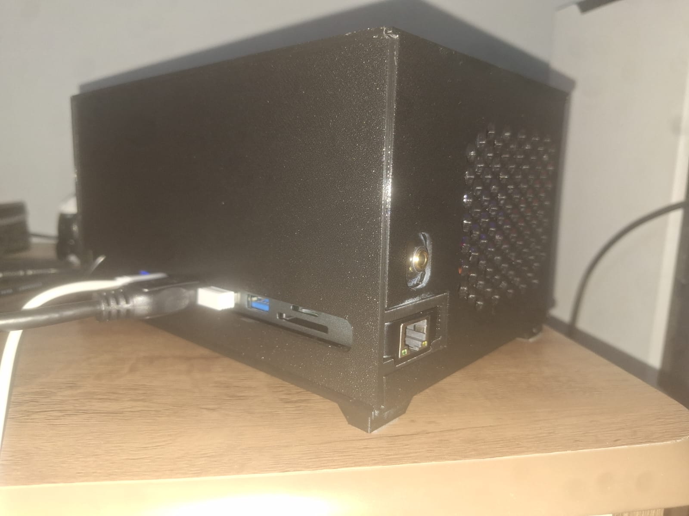
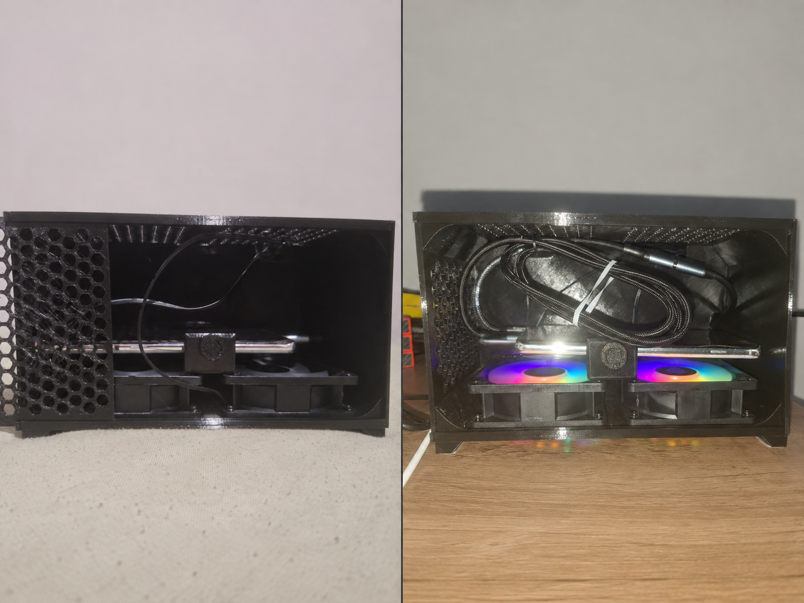
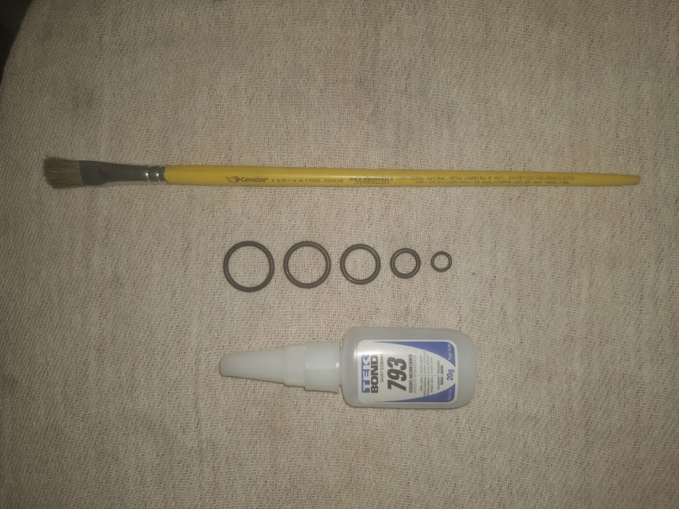
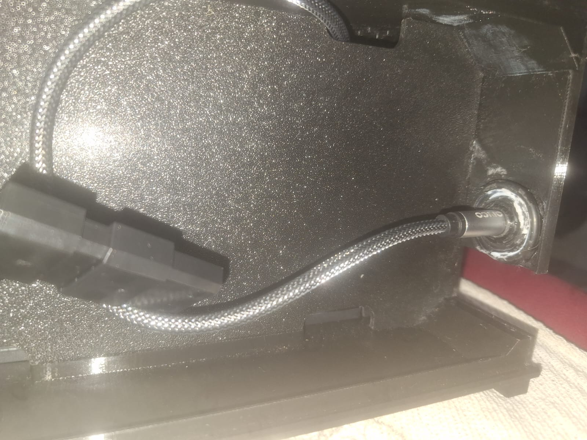
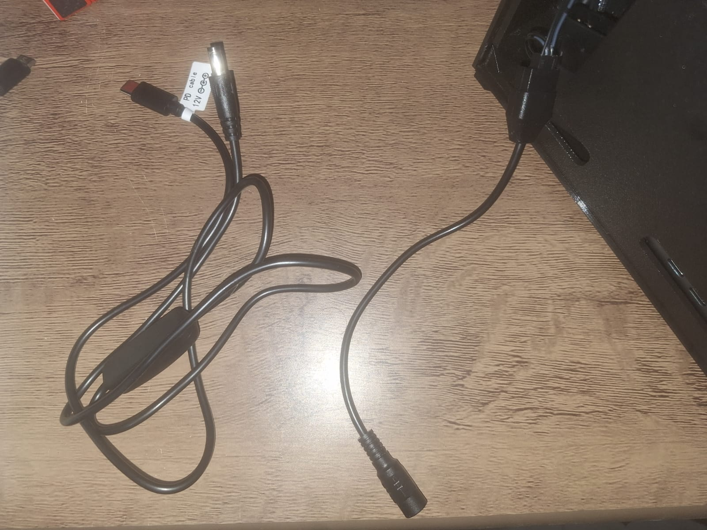

# Hardware

[Português](hardware.pt.md)

Linudex uses a Samsung Galaxy S10+ with a damaged display as the foundation of an ARM desktop environment. Version v0.4.0 extends the original hardware documentation to cover physical integration of the smartphone, USB-C hub, external connections and cooling inside a compact enclosure.

## Main device

The main device remains a **Samsung Galaxy S10+ (SM-G975F)** with a damaged built-in display but functional core hardware for this project.

| Component               | Specification / status            |
| ----------------------- | --------------------------------- |
| SoC                     | Samsung Exynos 9820               |
| Architecture            | ARM64 / AArch64                   |
| RAM                     | 8 GB nominal                      |
| Internal storage        | 128 GB                            |
| USB                     | USB-C                             |
| External display output | Samsung DeX via HDMI on a monitor |
| Built-in display        | Physically damaged                |

<p align="center">
  
  
  
</p>

## Hardware history and initial testing

In v0.1, the Linux environment was validated using an external display through Samsung DeX and external input devices as needed. The models of the peripherals used in the initial tests were not recorded.

Android reported battery health as `GOOD` during the baseline; charging was limited to 85% for stationary use. RAM Plus was set to 8 GB and represents storage-backed virtual memory rather than additional physical RAM.

Previously documented desktop tests recorded **battery** temperatures between **27.8 °C and 33.0 °C**. The most noticeable early heating was associated with the damaged internal display remaining on; the device cooled when the display was turned off during DeX use. These readings are not SoC temperatures and do not establish a cooling benefit from the v0.4 fans.

## Physical integration — v0.4.0

Version v0.4.0 integrates the device into a **Brothers Repair Nano mini enclosure**. The goal is to house the smartphone, hub and wiring neatly while keeping external interfaces accessible and preparing active airflow.

The build uses an 8-in-1 USB-C hub, USB-C extension, 3.5 mm audio extension, HDMI cable, input peripherals and two 80 mm fans. A dedicated monitor has not yet been purchased; a monitor from the user's PC is being used temporarily.

## Connectivity and USB-C hub

The hub connects the Galaxy S10+ to peripherals and the external display. According to its manual, its interfaces include:

| Interface                          | Reported function / specification                                   |
| ---------------------------------- | ------------------------------------------------------------------- |
| USB-C connector for computer/phone | Connection to the Galaxy S10+                                       |
| USB-C female port 1                | PD input, `20V@3A`; manual states support for up to an 87 W adapter |
| USB-C female port 2                | USB-C data port, up to 4.5 W supplied to peripherals                |
| USB-A (2 ports)                    | Keyboard, mouse, storage and other peripherals                      |
| HDMI/HDTV                          | External display output                                             |
| Ethernet                           | Wired network                                                       |
| SD and TF/microSD                  | Memory card readers                                                 |

The hub ports were tested working simultaneously. The second USB-C port is **not a PD charging input**, it is a MTP input.

The hub and its video path are functional in the current build.



## Smartphone positioning and USB-C extension

The original S10+ mounting orientation placed the power button against an internal case support. Tightening the support could keep the button pressed, risking unintended activation.

A **USB-C male-to-female extension cable** allowed the phone to be mounted in the reverse orientation while preserving a working connection to the hub and Samsung DeX. The Power button is now clear; however, the volume and Bixby buttons may still be partly pressed. This should be monitored and corrected if it causes unintended inputs.

The adjustment addresses this particular enclosure geometry and is not a general requirement for Linudex. Details of the mechanical constraint will be recorded in the v0.4.0 [Troubleshooting](troubleshooting/README.md).



## Rear 3.5 mm audio jack

The Galaxy S10+'s built-in 3.5 mm audio output was extended using a **50 cm audio extension cable** to an available rear opening above the hub's Ethernet port.

The initial electrical-tape mounting did not prevent the jack from being pushed inside the case when plugging in headphones. The final solution used rubber washers of different diameters bonded together with cyanoacrylate adhesive. A paintbrush served as an improvised mandrel to gradually adjust the washers' inner diameter until the jack formed a tight interference fit. The assembly was glued to the internal case wall, allowed to cure for approximately 24 hours, and finished externally with electrical tape to conceal excess adhesive.

The jack now stays in place during insertion, while remaining removable with some force. The extension is **optional**: Linudex does not depend on it to operate.




## Electrical power

The build uses a multiport charger with USB-C PD and USB-A QC ports. The intended main connection is a charger PD output to the hub's PD input, supplying power to the smartphone.

The fan supply was connected as follows:

```text
USB-C PD charger
       │
USB-C PD → DC5521 cable (nominal 12 V)
       │
DC5521 → small 4-pin fan header adapter
       │
Two connected 80 mm fans
```

The purchased adapter was initially mistaken for a large peripheral Molex adapter (IDE/LP4), but its output is a small fan connector. One of the small fan connectors accepted the adapter and **both motors spun**, indicating an electrical interconnection within the assembly; the exact connection between them comes from the link between their LP4 Molex connectors.

The fans operated for 20 minutes without reported interruptions, noticeable connector heat or unusual odor. The charger produced **a faint high-pitched noise in one low-load condition**, especially when the cable remained connected with the fans turned off by its switch; the cause was not established. Although operation was demonstrated, **actual output voltage, polarity and current have not been measured**. The charger's advertised aggregate wattage does not establish that its port supports a 12 V PD profile.

The power strip/filter accessory is optional external power distribution equipment, not part of the phone's internal electrical circuit.

See [Architecture](architecture.md) for the connection diagrams. Never energize both power interfaces on the same fan at the same time.



## Active cooling

The build uses **two 80 mm fans**, installed at the bottom of the enclosure. A paper-strip test confirmed that both **pull air from inside and exhaust it outside**. Upper, frontal and side openings provide potential passive intake.

Both fans ran throughout a 20-minute functional test. In reported thermal tests lasting 20 minutes per configuration, YouTube 1080p playback resulted in **35.2 °C with fans on** versus **40.2 °C with fans off** (5.0 °C observed difference). Starting conditions differed and SoC temperature was not measured, so this gap cannot all be attributed to the fans without better-controlled testing.

See [Benchmarks](benchmarks.md) for the full table. The present dual-exhaust arrangement was retained following these tests.

## Video and peripherals

The hub provides HDMI output to an external monitor. The **2 m HDMI cable has already been purchased and tested successfully** using a monitor from the user's PC. Video output is therefore functional even though a dedicated monitor has not yet been purchased.

The wireless keyboard and mouse kit is in use; the hub also supports wired USB input devices. Its SD and microSD slots are available, but purchasing memory cards remains an optional future storage expansion.

## Pending v0.4.0 validation

- Measure actual fan supply voltage, polarity and current using appropriate equipment (planned for a later stage).
- Optionally repeat thermal tests under controlled ambient and starting temperatures.

A dedicated monitor is not required to complete the physical integration: HDMI output has already been validated using an existing display. A later monitor purchase can be documented without retroactively changing v0.4.0 measurements.

Component costs are recorded in the [bill of materials](../bom/components.md).
