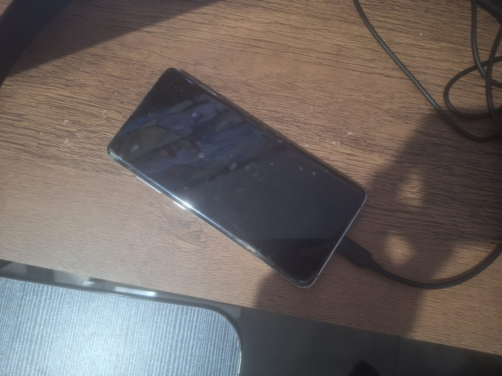
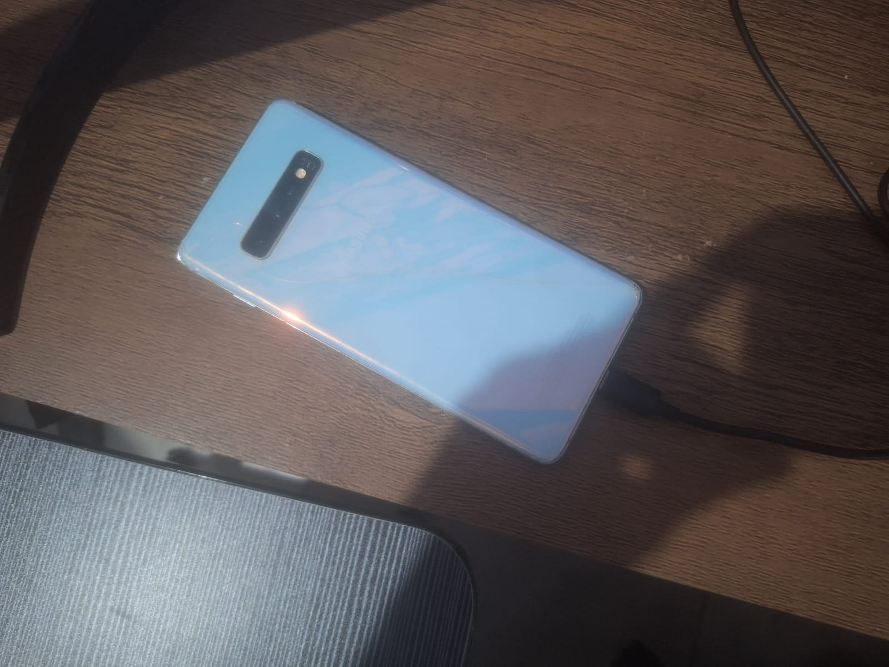
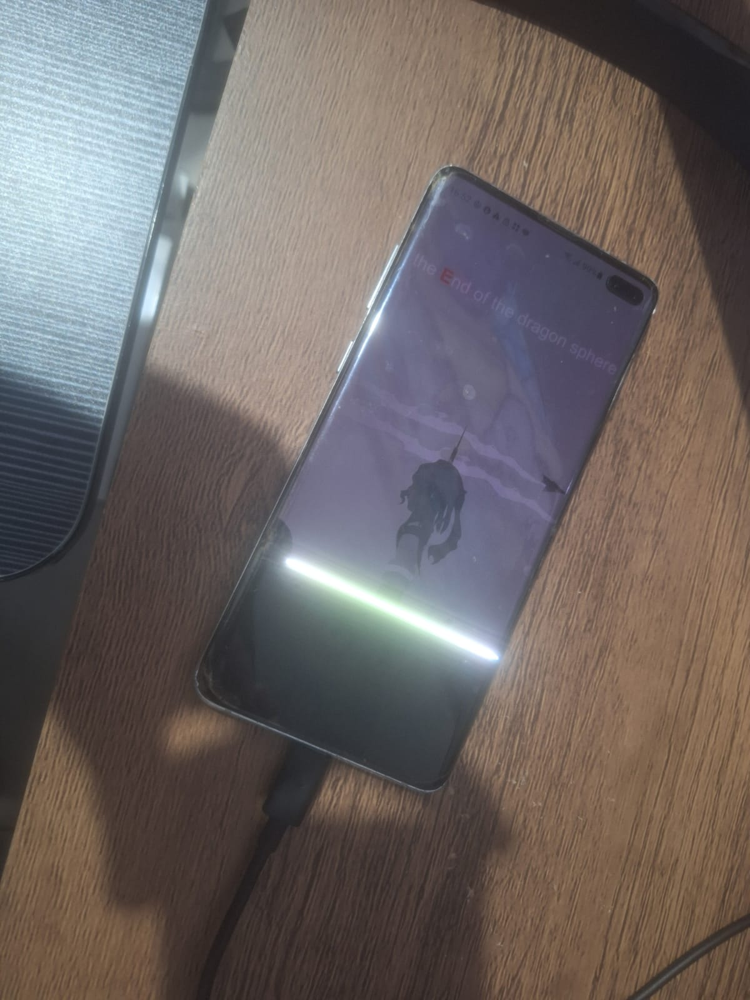

# Hardware

[English](hardware.md)

O Linudex utiliza um Samsung Galaxy S10+ com a tela danificada como base de um ambiente desktop ARM. A v0.4.0 amplia a documentação original de hardware e registra a integração física do smartphone, do hub USB-C, das conexões externas e da refrigeração em um gabinete compacto.

## Dispositivo principal

O dispositivo principal permanece o **Samsung Galaxy S10+ (SM-G975F)**, com tela integrada danificada, mas com o hardware necessário ao projeto funcional.

| Componente            | Especificação / estado             |
| --------------------- | ---------------------------------- |
| SoC                   | Samsung Exynos 9820                |
| Arquitetura           | ARM64 / AArch64                    |
| RAM                   | 8 GB nominal                       |
| Armazenamento interno | 128 GB                             |
| USB                   | USB-C                              |
| Saída de tela externa | Samsung DeX com HDMI em um monitor |
| Tela integrada        | Fisicamente danificada             |

<p align="center">
  
  
  
</p>

## Histórico de hardware e testes iniciais

Na v0.1, o ambiente Linux foi validado com monitor externo através do Samsung DeX e dispositivos de entrada externos conforme necessário. Os modelos dos periféricos utilizados inicialmente não foram registrados.

O Android reportou saúde da bateria `GOOD` durante o baseline; o limite de carga foi configurado em 85% para o uso estacionário. O RAM Plus estava configurado em 8 GB e corresponde a memória virtual baseada em armazenamento, não a RAM física adicional.

Os testes de desktop documentados anteriormente registraram temperaturas **da bateria** entre **27,8 °C e 33,0 °C**. O aquecimento mais evidente observado no início estava associado à tela integrada danificada quando permanecia acesa; com a tela apagada durante o DeX, o dispositivo esfriou. Essas medições não representam a temperatura do SoC e não comprovam o ganho térmico dos coolers da v0.4.

## Integração física — v0.4.0

A fase v0.4.0 integra o aparelho a um **mini gabinete Nano da Brothers Repair**. O objetivo é reunir o smartphone, o hub e a fiação de maneira organizada, mantendo as interfaces externas acessíveis e preparando um fluxo de ar ativo.

A montagem incorpora um hub USB-C 8 em 1, extensor USB-C, extensão de áudio P2, cabo HDMI, periféricos de entrada e dois fans de 80 mm. O monitor dedicado ainda não foi comprado; um dos monitores do PC está sendo utilizado temporariamente.

<!-- Imagens futuras: visão geral do gabinete, interior e painel traseiro (../images/build/). -->

## Conectividade e hub USB-C

O hub concentra a conexão do Galaxy S10+ com os periféricos e a tela externa. Segundo seu manual, as interfaces incluem:

| Interface                      | Função / especificação informada                                     |
| ------------------------------ | -------------------------------------------------------------------- |
| USB-C para computador/telefone | Conexão com o Galaxy S10+                                            |
| USB-C fêmea 1                  | Entrada PD, `20V@3A`; manual informa suporte a adaptador de até 87 W |
| USB-C fêmea 2                  | Porta USB-C de dados, fornecimento para periféricos de até 4,5 W     |
| USB-A (2 portas)               | Teclado, mouse, armazenamento e periféricos                          |
| HDMI/HDTV                      | Saída de vídeo para tela externa                                     |
| Ethernet                       | Rede cabeada                                                         |
| SD e TF/microSD                | Leitura de cartões de memória                                        |

As portas do hub foram testadas com funcionamento simultâneo. A segunda USB-C **não é uma entrada de carregamento PD**, é uma entrada MTP.

O hub e seu caminho de vídeo estão funcionais na montagem atual.

<!-- IMAGEM FUTURA: fotografia da conexão do hub (images/build/). Diagrama Mermaid já incluído em architecture.pt.md. -->

## Posicionamento do smartphone e extensor USB-C

A fixação original do S10+ colocava o botão de ligar/desligar voltado para o suporte interno do gabinete. O aperto podia manter o botão pressionado, criando risco de acionamentos involuntários.

Um **extensor USB-C macho → fêmea** permitiu inverter o posicionamento do aparelho sem perder a conexão funcional com o hub e o Samsung DeX. Nessa posição, o botão Power ficou livre; entretanto, os botões de volume e Bixby podem permanecer parcialmente pressionados. O comportamento deve ser monitorado e corrigido se causar entradas involuntárias.

O ajuste foi realizado para a geometria deste gabinete e não constitui uma exigência geral para utilizar o Linudex. Os detalhes da restrição mecânica serão registrados no [Troubleshooting](troubleshooting/README.pt.md) da v0.4.0.

<!-- Imagens futuras: posicionamento antes/depois e passagem do extensor USB-C. -->

## Saída de áudio P2 traseira

A saída nativa de 3,5 mm do Galaxy S10+ foi prolongada por um **extensor P2 de 50 cm** até a abertura disponível na traseira do gabinete, acima da porta Ethernet.

A primeira fixação com fita isolante não impedia que o jack recuasse para dentro ao conectar um fone. A solução definitiva utilizou arruelas de borracha de diferentes diâmetros, unidas com cianoacrilato. Um pincel serviu como mandril improvisado para ajustar gradualmente o diâmetro interno das arruelas até obter um encaixe por interferência no conector. O conjunto foi colado à parede interna, com cura de aproximadamente 24 horas, e o acabamento externo recebeu fita isolante para ocultar resíduos de cola.

O jack agora fica firme durante a conexão, embora ainda possa ser removido com esforço. Essa extensão é **opcional**: o Linudex não depende dela para funcionar.

<!-- Imagens futuras: materiais, montagem das arruelas, fixação interna e acabamento do jack P2. -->

## Alimentação elétrica

O conjunto utiliza um carregador multiportas com portas USB-C PD e USB-A QC. A conexão principal prevista é uma saída PD do carregador para a entrada PD do hub, que fornece energia ao smartphone.

A cadeia utilizada para os fans é:

```text
Carregador USB-C PD
        │
Cabo USB-C PD → DC5521 (12 V nominal)
        │
Adaptador DC5521 → conector pequeno de fan 4 pinos
        │
Conjunto de 2 fans de 80 mm
```

O adaptador adquirido foi inicialmente confundido com um adaptador para Molex periférico grande (IDE/LP4), mas sua saída é um conector pequeno de ventoinha. Um dos conectores pequenos dos fans aceitou o adaptador e **ambos os motores giraram**, indicando interligação elétrica do conjunto; a ligação exata entre eles vem da conexão entre o molex LP4 deles.

A alimentação funcionou por 20 minutos sem interrupções relatadas, aquecimento perceptível nos conectores ou cheiro anormal. O carregador apresentou **chiado discreto em uma condição de baixa carga**, principalmente com os fans desligados pelo interruptor do cabo e ainda conectados; sua causa não foi confirmada. O uso foi testado, mas **a tensão real de 12 V, polaridade e corrente ainda não foram medidas**. A potência total anunciada do carregador não comprova a presença de um perfil PD de 12 V.

A extensão/filtro de linha é um acessório opcional de distribuição elétrica do setup, não parte do circuito interno do telefone.

Veja os diagramas em [Arquitetura](architecture.pt.md). Nunca energize simultaneamente as duas interfaces de alimentação de um mesmo fan.

<!-- IMAGEM FUTURA: conector pequeno compatível, adaptador DC5521 e cabeamento final (images/build/). -->

## Refrigeração ativa

A montagem utiliza **dois coolers de 80 mm**, instalados na parte inferior do gabinete. O teste com papel confirmou que ambos **puxam o ar do interior e o expulsam para o exterior** (exaustão). Existem aberturas passivas superiores, frontais e laterais.

Ambos os coolers giraram e permaneceram ligados durante um teste de 20 minutos. Nos testes térmicos relatados com 20 minutos por configuração, a leitura durante YouTube 1080p foi de **35,2 °C com os fans ligados**, contra **40,2 °C com os fans desligados** (diferença observada de 5,0 °C). As condições iniciais não eram idênticas e não houve medição da temperatura do SoC, portanto esse valor não pode ser atribuído integralmente à refrigeração sem um ensaio mais controlado.

Confira a tabela completa em [Benchmarks](benchmarks.pt.md). A configuração atual com ambos os fans em exaustão foi mantida após os testes.

<!-- IMAGENS FUTURAS: posicionamento dos fans, grade lateral, aberturas superiores e montagem final (images/build/). -->

## Vídeo e periféricos

O hub fornece saída HDMI para monitor externo. O **cabo HDMI de 2 metros já foi adquirido e testado com sucesso**, utilizando temporariamente um dos monitores do PC. Portanto, a saída de vídeo da montagem está funcional, mesmo sem monitor dedicado.

O kit de teclado e mouse sem fio está em uso; o hub também permite periféricos USB com fio. Os leitores SD e microSD estão disponíveis no hub, mas a compra de cartões para expansão de armazenamento permanece opcional.

## Pendências de validação da v0.4.0

- Medir com instrumento adequado a tensão efetiva, a polaridade e o consumo na linha dos fans (programado para uma etapa futura).
- Realizar eventual repetição dos testes térmicos em condições ambientais e temperaturas iniciais controladas.

A ausência de monitor próprio não impede o fechamento da integração física: a saída HDMI já foi testada com um monitor emprestado do setup existente. Uma aquisição posterior pode ser documentada sem alterar retroativamente os resultados da v0.4.0.

Os custos dos componentes estão na [lista de materiais](../bom/components.pt.md).
