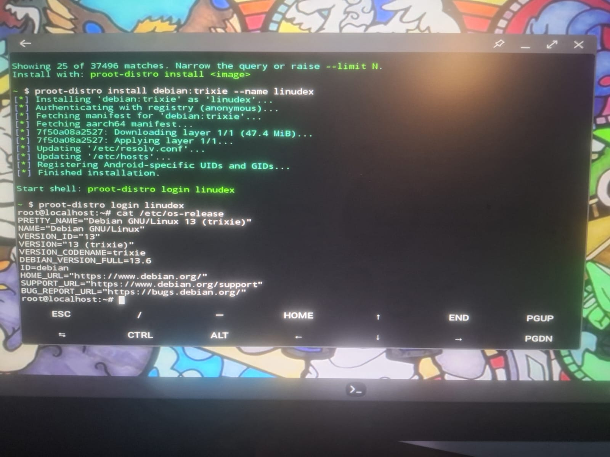
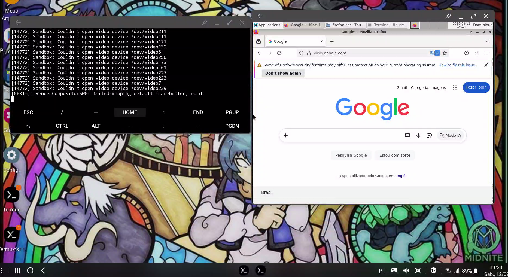
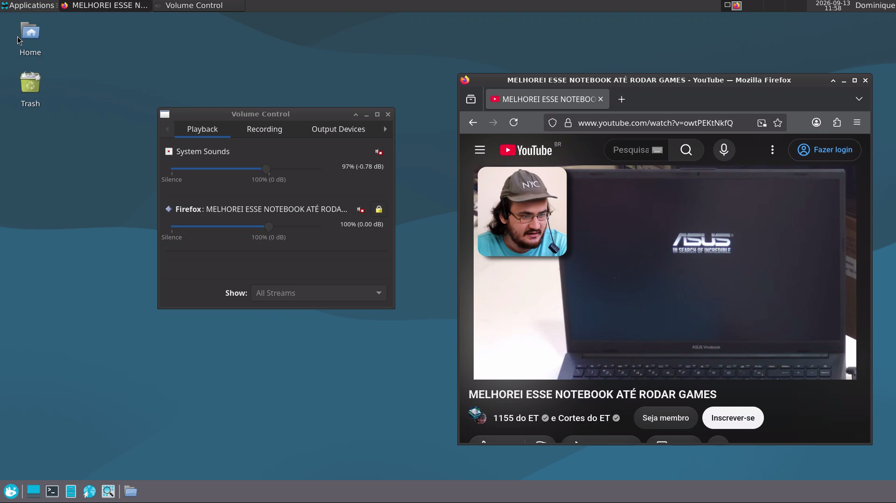
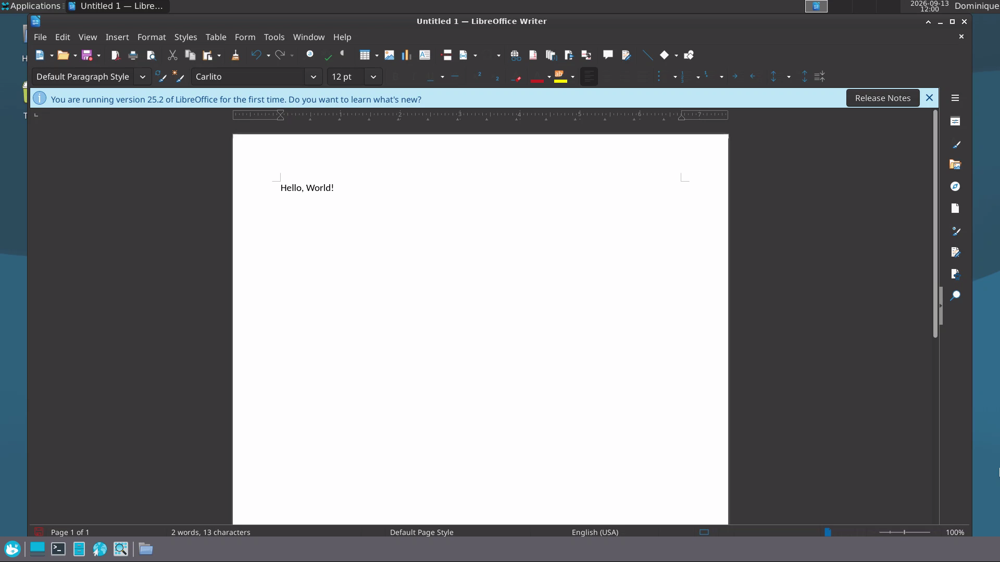

# Software Setup

[Português](software.pt.md)

This document records the software stack used by the Linudex v0.2.0 daily-driver milestone.

## Final v0.2.0 stack

```text
Android 12 / One UI 4.1
├── Samsung DeX
├── Termux:Boot
├── Termux:Widget
└── Termux (F-Droid build)
    ├── PulseAudio
    ├── Termux:X11
    └── PRoot-Distro
        └── Debian 13 ARM64 (`linudex`)
            └── XFCE
```

## 1. Termux host

Termux was installed from F-Droid. The host environment was updated and the core packages were installed through the project scripts. The v0.2.0 host requirements include:

```text
git
curl
wget
nano
openssh
proot-distro
x11-repo
termux-x11-nightly
pulseaudio
```

The device architecture was confirmed with:

```bash
uname -m
```

Expected architecture:

```text
aarch64
```

## 2. Debian installation

Debian 13 ARM64 was installed through PRoot-Distro with the local installation name `linudex`.

The environment is entered with:

```bash
proot-distro login linudex
```

The basic Debian setup included updating packages and installing common core utilities:

```bash
apt update
apt upgrade
apt install -y sudo git curl wget nano ca-certificates locales procps htop file unzip zip
```



## 3. Non-root desktop user

A dedicated user named `linudex` was created for normal desktop use.

Because PRoot-Distro login sessions did not expose the supplementary `sudo` group as expected, an explicit sudoers rule was added with `visudo`:

```text
linudex ALL=(ALL:ALL) ALL
```

The configuration was validated with:

```bash
sudo whoami
```

Expected result:

```text
root
```

See [Troubleshooting](troubleshooting/README.md) for the reason this was necessary.

## 4. XFCE

XFCE and D-Bus X11 support were installed inside Debian:

```bash
sudo apt update
sudo apt install -y xfce4 dbus-x11
```

The v0.2.0 desktop configuration uses:

- 1920×1080 Termux:X11 output.
- 115 DPI.
- XFCE compositor disabled.
- 40 px panel with Whisker Menu.
- Simplified desktop layout.
- `Ctrl+Alt+T` for `xfce4-terminal`.
- `Super+E` for Thunar.
- `Super+B` for Firefox ESR.

The corresponding reproducible configuration is kept under `configs/`.

## 5. Termux:X11

On the Termux side, the X11 repository and Termux:X11 command-line component are installed through the setup script. The matching Android Termux:X11 application is also required.

Because the main Termux installation came from F-Droid, the non-`sharedUid` Termux:X11 APK variant was used.

The v0.2.0 preferences use exact 1920×1080 output and fullscreen mode. The exported Termux:X11 preferences are stored under `configs/termux/`.

## 6. Graphical session startup

The normal v0.2.0 workflow uses `scripts/termux/start-linudex.sh` rather than manually entering each command.

The script starts the stack in this order:

```text
PulseAudio
    ↓
Termux:X11 server
    ↓
Termux:X11 Android Activity
    ↓
PRoot-Distro
    ↓
Debian as user `linudex`
    ↓
D-Bus
    ↓
XFCE
```

The underlying Debian session still uses a shared temporary directory and `DISPLAY=:1`.



## 7. Shared Android storage

Android shared storage was enabled from Termux and exposed to the Debian user as `~/AndroidStorage`.

This provides a practical file exchange path between Android/DeX and the Debian desktop without copying files through ADB or network services.

## 8. Audio integration

PulseAudio runs on the Termux side and exposes a local TCP server. Debian applications use:

```text
PULSE_SERVER=tcp:127.0.0.1
```

The resulting path is:

```text
Debian application
       ↓
PulseAudio client
       ↓
tcp:127.0.0.1
       ↓
Termux PulseAudio
       ↓
Android / DeX audio
```

Audio was validated with Firefox ESR and the PulseAudio Volume Control interface.



## 9. Essential applications

The v0.2.0 daily-driver environment includes:

- Firefox ESR.
- Evince.
- VLC.
- Ristretto.
- Mousepad.
- Galculator.
- Xarchiver and Thunar archive integration.
- LibreOffice Writer, Calc and Impress.
- Brazilian Portuguese LibreOffice localization and spell checking.
- Carlito, Caladea, Liberation and Noto fonts for improved document compatibility.

The package list is automated by `scripts/debian/install-apps.sh`.



## 10. Automatic startup and manual control

Termux:Boot is used to start Linudex automatically after Android boot. The boot script waits for `sys.boot_completed`, allows the graphical environment to settle and then runs `start-linudex.sh`.

The boot process writes to:

```text
~/linudex-boot.log
```

Because Android can restrict Activities started from the background, Termux was granted the **Appear on top** permission so the Termux:X11 Activity can open automatically during boot.

Termux:Widget provides manual `Start-Linudex` and `Stop-Linudex` shortcuts for cases where the Debian environment needs to be started or stopped from Android/DeX.

## 11. Android host tuning

For the v0.2.0 environment:

- Termux and Termux:X11 are configured without battery restrictions.
- RAM Plus is set to 8 GB. This is storage-backed virtual memory, not physical RAM.
- Charging is capped at 85% to reduce battery wear during stationary use.
- Android Developer Options **Logger buffer size** is set to **Disabled**.
- Android Developer Options **Accelerated processing** is enabled.
- Android 12's phantom-process limit is increased during testing after repeated `signal 9` process termination. See [Troubleshooting](troubleshooting/README.md).

The logger-buffer and accelerated-processing options are documented as host tuning choices; no isolated benchmark was performed to attribute a quantified performance gain to either option.

## 12. Current v0.2.0 limitations

- The current Phantom Process Killer workaround uses temporary `until_reboot` behavior and may need to be reapplied after a device reboot.
- Final keyboard layout validation depends on the physical keyboard.
- Final mouse tuning and display scaling should be validated again with the definitive monitor/hub setup.
- Automatic cold boot directly into the final Samsung DeX HDMI setup still requires hardware validation.
- The physical enclosure and active-cooling build belong to the hardware phase.

## 13. Experimental x86/x86-64 compatibility (v0.3.0)

The v0.2.1 desktop remains the stable base. Version v0.3.0 adds optional compatibility components for Linux and Windows x86-64 software, without changing the normal XFCE boot sequence.

### Tested software

| Component             | Tested version               | Notes                                          |
| --------------------- | ---------------------------- | ---------------------------------------------- |
| Box64, Wine baseline  | 0.3.4 (`/usr/bin/box64`)     | Working baseline for Windows applications      |
| Box64, Linux programs | Manually compiled 0.4.5      | Local wrapper `~/run-x86_64.sh`                |
| Wine                  | 9.18-staging                 | Selected prefix `.xow64_test`                  |
| WineD3D               | 9.2                          | Direct3D compatibility                         |
| VirGL / ANGLE         | OpenGL and Direct3D profiles | Android-facing Vulkan bridge                   |
| DepotDownloader       | 3.4.0 Linux ARM64            | Steam depot downloader, without SteamWebHelper |

These are versions used during development, not an automated clean-install recipe. The locally tested GPU and compatibility wrappers are not yet all published in the repository.

### Linux x86-64 graphics profile

Run in **Termux** when the desktop is already active:

```bash
~/start-linux-gpu.sh
```

The helper selects the `gl` profile and `vulkan` ANGLE mode. Inside **Debian**, Linux x86-64 applications are launched through the locally configured Box64 wrapper. Xonotic was tested with this route.

### Windows x86-64 graphics profile

Run in **Termux**:

```bash
~/start-wine-gpu.sh
```

Enter Debian with the shared X11 temporary directory when necessary:

```bash
proot-distro login linudex --user linudex --shared-tmp --env DISPLAY=:1 --env PULSE_SERVER=tcp:127.0.0.1
```

Run in **Debian**, using the already configured Wine prefix:

```bash
cd "$HOME/xow64_prefix/.xow64_test/drive_c/Games/Seraph-Depot"
~/xow64 r "Seraph's Last Stand.exe"
```

For shutdown, use `~/stop-xow64-wine.sh` from Debian. Avoid the experimental `~/xow64 q` command because it may also terminate unrelated X11/desktop processes. Do not restart the whole desktop just to switch the compatibility profile unless needed.

### DepotDownloader

The native ARM64 DepotDownloader 3.4.0 release was installed in `~/opt/depotdownloader-3.4.0`. Under the tested Android/PRoot environment, its .NET runtime required the following environment setting to start:

```bash
DOTNET_GCHeapHardLimit=1C0000000
```

This value is a .NET GC heap limit, not a requirement for 7 GiB of physically available RAM. The local `~/depotdownloader.sh` helper exports it before launching the application. User credentials and Steam Guard codes must be entered interactively and must not be committed to the repository.

DepotDownloader can download files for owned games without running the full Steam UI. It does not ensure a game works without the Steam client or bypass DRM/Steamworks requirements.

### Compatibility status

- Linux x86-64: Xonotic ran with the Box64/OpenGL graphics route.
- Windows x86-64: Seraph's Last Stand ran without keeping Steam open, with low observed performance.
- Windows x86-64: 9 Kings initialized Unity but did not reach gameplay; graphics feature limitations and Steam launch behavior were observed.
- Linux x86-64: Terraria started its binary through Box64 but requested launching through the Steam client.

Measured performance and reproducibility limitations are documented in [Benchmarks](benchmarks.md), with diagnostic details in [Troubleshooting](troubleshooting/README.md).

## 14. Windows 10-inspired desktop interface

Linudex v0.5.0 customizes Debian 13 ARM64 XFCE without replacing the Termux:X11, PRoot-Distro, or Samsung DeX base. The result was validated on the development Galaxy S10+.

### Desktop and dependencies

- B00merang **Windows 10** GTK and icon themes installed per user in `~/.themes/Windows 10` and `~/.icons/Windows 10`.
- Full-width dark bottom XFCE panel, configured height **40 px**, with border styling; upper panel automatically hidden. The exported current `xfwm4.xml` reports `use_compositing=true`, unlike earlier releases.
- **Whisker Menu** uses `~/share/icons/linudex/lx.png` and a GTK CSS-sized clickable button. **Docklike** groups running windows and pinned applications.
- **280 px** search launcher invoking `xfce4-appfinder --collapsed`; SVG at `~/.local/share/linudex/search.svg`. This is a clickable launcher, not an editable search field.
- **Genmon** Wi-Fi and battery indicators, PulseAudio, system tray and digital clock (time `%R`, date `%d/%m/%Y`).
- Custom Genmon **Show Desktop** button using `xprop -root _NET_SHOWING_DESKTOP` and `wmctrl -k on|off`, replacing the default XFCE panel widget.

Required XFCE components include `xfce4-whiskermenu-plugin`, `xfce4-docklike-plugin`, `xfce4-genmon-plugin`, `xfce4-pulseaudio-plugin`, and `xfce4-panel-profiles`; utilities include `wmctrl`, `x11-utils` (for `xprop`), and Python 3. The desktop runs under Termux:X11 display `:1` with an XFCE D-Bus session.

### Brazilian keyboard and shortcuts

XFCE uses XKB layout `br` with **no variant**, corresponding to the regular ABNT2 keymap. The Debian graphical session sets `LANG=pt_BR.UTF-8`. Crucially, the Android **Termux:X11 app** must have **Prefer scancodes when possible** enabled for reliable dead-key composition; importing XFCE XML files does not set this Android preference.

| Shortcut  | Validated action                                                                                      |
| --------- | ----------------------------------------------------------------------------------------------------- |
| `Super`   | Whisker Menu                                                                                          |
| `Super+E` | Thunar                                                                                                |
| `Super+R` | Collapsed Application Finder                                                                          |
| `Super+T` | XFCE Terminal                                                                                         |
| `Super+D` | Show Desktop (the final XML binding must still be checked; it was missing from the exported snapshot) |
| `Alt+Tab` | Switch windows                                                                                        |
| `Alt+F4`  | Close active window                                                                                   |

### Android status integration

A host Termux monitor runs `termux-battery-status` and `termux-wifi-connectioninfo` (the **Termux:API** command package and companion Android app). JSON data are written to the Termux `$HOME/.linudex/status/` directory, and Debian's `linudex-status` generates icons and labels for Genmon. The host monitor polls both commands sequentially and sleeps for 45 seconds per cycle; both panel Genmon instances refresh every 15 seconds. Data older than 180 seconds, or invalid data, are shown as unavailable. Start/Stop and session cleanup scripts should control the monitor. See [Architecture](architecture.md).

### Chromium ARM64, Widevine and WebApps

**Chromium 156.0.8078.79** was tested on Debian 13 ARM64. The local `/usr/local/bin/chromium-gpu` wrapper uses `GALLIUM_DRIVER=virpipe`, `--use-gl=egl`, `--ignore-gpu-blocklist`, and, in the only working configuration, `--no-sandbox` and `--disable-gpu-sandbox`. Its `exec` command must forward additional arguments with `"$@"`. **Chromium could not launch with its sandbox enabled** in the tested PRoot environment: this is an **experimental, insecure browser configuration**, not an appropriate default for unrestricted browsing. See [Troubleshooting](troubleshooting/troubleshooting-v0.5.0.md).

A global ChromeOS User-Agent override interfered with Cloudflare challenges; restoring the regular User-Agent resolved those tested challenges. Netflix required a separate ChromeOS-like User-Agent and Widevine. DRM was installed through the external [Asahi Linux Widevine Installer](https://github.com/AsahiLinux/widevine-installer), with helper dependencies such as `squashfs-tools`.

To install **Netflix** and **YouTube** WebApps, select **⋮ → Cast, save and share → Install [site]** in Chromium. Locate the generated `.desktop` under `~/.local/share/applications/`, then align its `Exec`, `--app=https://...`, `--class=AppClass` and `StartupWMClass=AppClass` values; retain Chromium's generated `Icon=`. A dedicated `--user-data-dir` can separate an app profile where appropriate. For YouTube, the successful Docklike pinning method was **open the WebApp, right-click its running-window icon, and choose Pin to Dock**; attempting to pin it via Whisker did not work.

Netflix's User-Agent override is scoped to its own launcher, leaving the regular browser unmodified. The command suffix confirmed: `--user-agent="Mozilla/5.0 (X11; CrOS aarch64 15329.44.0) AppleWebKit/537.36 (KHTML, like Gecko) Chrome/130.0.0.0 Safari/537.36" "$@"`. Verify the actual final `Exec` on-device before copying it elsewhere.

### Assets and deployment

Store reproducible configurations and original Linudex artwork under `configs/`. The wallpaper will be supplied later under `images/`; it was not present in the exported backup. Chromium generates Netflix and YouTube icons on installation; these are not repository-provided dependencies. Apply the consolidated GTK CSS only after a visual comparison on-device. See [`configs/README.md`](../configs/README.md) and [`scripts/README.md`](../scripts/README.md) for deployment guidance.

## 15. Desktop usability refinements

v0.5.1 retains the Android/Termux/PRoot-Distro/Debian foundation and updates the **lower XFCE panel**, which is now the only panel in use. The redundant upper panel was removed. The existing Docklike, Whisker Menu and status indicators remain in place.

### LinuDex Search

The v0.5.0 visual launcher was replaced with **LinuDex Search v3**, a C/GTK 3 XFCE Panel plugin. Its editable taskbar field is 280 px wide and approximately 36 px high. Search results appear above the panel in a separate GTK window, showing up to eight matching applications with names and icons. Searching by application name, launching by click or Enter, navigating with arrow keys, closing with Esc, clearing after launch and dismissal on focus loss were validated.

The appearance retains the original `#343434` background, `#585858` border, vector magnifier and _Pesquisar_ label. The icon and actual text label are separate to avoid overlap and reduced contrast. Result icons are proportionally constrained to **24 × 24 px**, correcting an oversized LocalSend icon. The plugin's CSS remains isolated under `~/.config/linudex-search/style.css` without replacing the panel's GTK stylesheet.

Building on Debian 13 ARM64 required `build-essential`, `pkg-config`, `libgtk-3-dev`, `libxfce4panel-2.0-dev`, and `libxfce4ui-2-dev`. The local source bundle contains `linudexsearch.c`, `linudexsearch.desktop`, `search-icon.svg`, `style.css`, `build.sh`, and `install.sh`. Installation places the library in XFCE's panel plugin directory, followed by `xfce4-panel -r`. **The v0.5.1 source and configuration files must be committed to the repository before the release tag is created.**

### Utilities menu and Android shortcuts

A new **up-arrow** Genmon launches `linudex-quickmenu`, an on-demand GTK menu containing **Bluetooth** (Android settings), **Photo Gallery** (`gthumb`), and **Settings** (`xfce4-settings-manager`). The menu uses a dark `#202020` background, `#383838` highlight, and English labels. No persistent daemon is needed after the menu closes.

The Wi-Fi Genmon became clickable through `linudex-wifi-click`, which reuses the output of `linudex-status wifi` and adds `<iconclick>`. The existing connection-status icon remains; its final scale is **0.75**, applied through a CSS selector scoped to `genmon-14`. Clicking opens **Android Wi-Fi settings**, rather than a Debian network manager without control over the phone's hardware.

Android settings shortcuts use `linudex-android-settings` and TermuxAm at `/data/data/com.termux/files/usr/bin/am`, with `android.settings.WIFI_SETTINGS` and `android.settings.BLUETOOTH_SETTINGS`. Launching both activities from Debian was validated. Direct use of `/system/bin/am` was rejected because of a package/UID identity mismatch and must not be used by these shortcuts.

**Thunar** was given a recognizable folder icon through the launcher editor, without replacing the file manager. **gThumb** was installed as the photo gallery. Battery, clock, Docklike, and search behavior were retained during the final adjustments.

### Shared storage

Access to `~/AndroidStorage` initially failed in both Termux and Debian even though the symbolic links existed. Enabling Android's **All files access** special permission for **Termux and Termux:API** restored storage access; Debian access was confirmed without changes to PRoot, `--bind`, or startup scripts. This permission fix does not expand the v0.5.1 scope into a deeper Android–Debian integration redesign. See [Troubleshooting v0.5.1](troubleshooting/troubleshooting-v0.5.1.md).

## 16. Secure browsing and Android browser integration — v0.5.2

Version v0.5.2 reviews the security limitations of browsing inside a Debian PRoot environment. Chromium and Brave in the tested setup needed `--no-sandbox` or could not operate reliably with their usual sandbox requirements. This flag disables important browser isolation and is not an acceptable general-purpose security solution. Chromium remains available for the already tested Netflix/YouTube WebApps, with this known risk.

Firefox ESR was investigated using browser sandbox diagnostics and `/proc` process information. Some process observations included `NoNewPrivs: 1` and `Seccomp: 2`, but these findings were insufficient to establish that the full intended multi-process sandbox and namespace protections were functioning. Earlier diagnostics also indicated unavailable user namespaces. It is therefore **not accurate to claim either a fully validated sandbox or that all Firefox protections were absent**.

GNOME Web with Bubblewrap was attempted, but the tested Bubblewrap invocation failed with `execvp /usr/bin/true: No such file or directory`. The cause was not conclusively isolated. LibreWolf launched but performed poorly on heavier sites such as ChatGPT, YouTube and GitHub. These outcomes led to prioritizing the **Samsung Internet Android app** running natively under Samsung DeX, rather than relying on an unvalidated Linux browser sandbox under PRoot.

This is a practical deployment choice, not a certification or an audit of Samsung Internet. Android-side apps retain their own Android execution and security model; the XFCE launcher does not relocate the browser into Debian.

## 17. Performance and maintenance — v0.6.0

The tested Galaxy S10+ (`SM-G975F`) uses Exynos 9820/Mali-G76, Android 12, Termux 0.118.3 (F-Droid), Termux:X11 and Debian ARM64 in PRoot-Distro. Debian was updated from 13.6 to **13.8** (121 packages; simulation showed no additions/removals). After updating, `apt list --upgradable` and `dpkg --audit` reported no pending changes or inconsistencies.

### Startup and graphics

The existing `scripts/termux/start-linudex.sh` waits for the Termux:X11 socket with a bounded retry instead of a fixed initial two-second wait, fixes Android activity retries, and removes the redundant three-second delay before the status monitor. The modified startup passed `bash -n` and started the graphical session successfully. PulseAudio setup and broad stop behavior were preserved.

On Termux, `scripts/termux/start-linux-gpu.sh` manually starts `virgl_test_server_android --angle-gl`. In Debian, install `scripts/debian/linudex-gpu` to `~/.local/bin/linudex-gpu` and invoke `linudex-gpu glxgears -info` while the server is running. The helper sets `GALLIUM_DRIVER=virpipe` for a **single process**. Tests identified `virgl (ANGLE (ARM, Mali-G76, ...))`; `glxinfo -B` produced `BadMatch (X_GetImage)` although `glxgears` rendered normally. Do not set `MESA_GL_VERSION_OVERRIDE`, `MOZ_X11_EGL`, or `LD_PRELOAD` globally. Automatic VirGL start/stop/status and per-app optimization were deferred.

### Maintenance and preserved settings

Selected Linux browser cache directories under `~/.cache` were removed (approximately 1.1 GB in total cache before cleanup); application profiles and Mesa/Box64/XFCE caches were preserved. This saves storage, not proven RAM or speed. RSS/PSS inspection did not reveal abnormal XFCE panel usage. PRoot tests did not justify changing `--shared-tmp`, `--sysvipc`, `--link2symlink` or bindings. Android ADB checks confirmed standby bucket 5, allowed background execution, Doze exemptions for Termux/Termux:X11/Termux:API and the previously set phantom-process limit of 2147483647. Thermal status remained 0 in the sampled idle and ten-minute video/multitab scenarios. No new global power, thermal or RAM Plus configuration was applied. See [Benchmarks](benchmarks.md).
