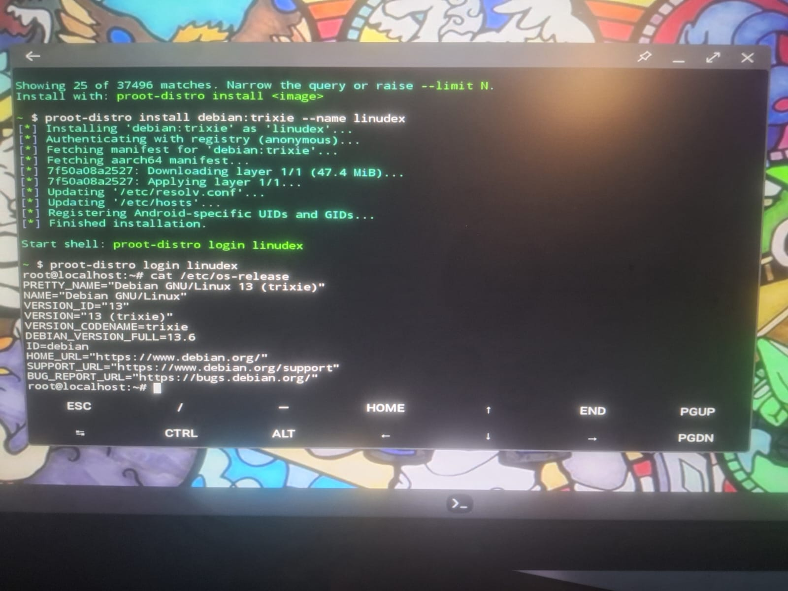
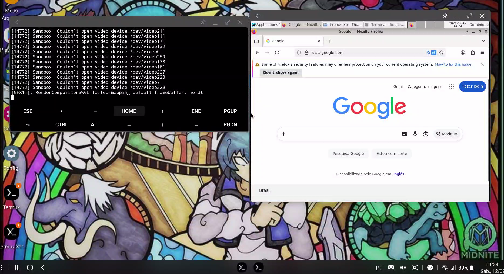
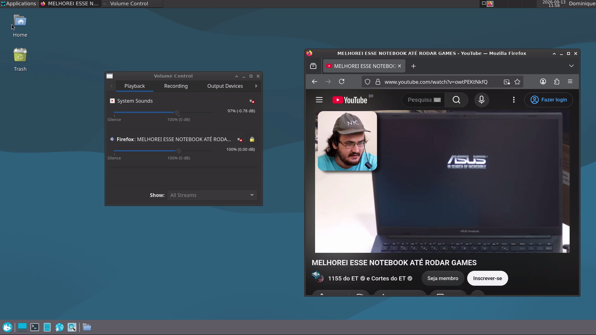
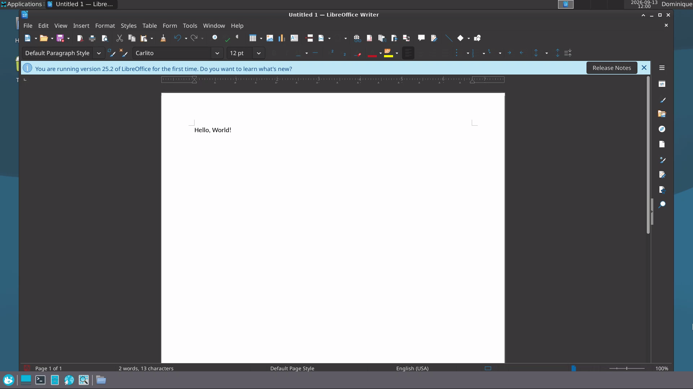

# Configuração de software

[English](software.md)

Este documento registra a pilha de software utilizada pelo marco Daily Driver do Linudex v0.2.0.

## Pilha final da v0.2.0

```text
Android 12 / One UI 4.1
├── Samsung DeX
├── Termux:Boot
├── Termux:Widget
└── Termux (build do F-Droid)
    ├── PulseAudio
    ├── Termux:X11
    └── PRoot-Distro
        └── Debian 13 ARM64 (`linudex`)
            └── XFCE
```

## 1. Host Termux

O Termux foi instalado pelo F-Droid. O ambiente host foi atualizado e os pacotes principais passaram a ser instalados pelos scripts do projeto. Os requisitos do host na v0.2.0 incluem:

```text
git
curl
wget
nano
openssh
proot-distro
x11-repo
termux-x11-nightly
pulseaudio
```

A arquitetura do aparelho foi confirmada com:

```bash
uname -m
```

Arquitetura esperada:

```text
aarch64
```

## 2. Instalação do Debian

O Debian 13 ARM64 foi instalado através do PRoot-Distro com o nome local `linudex`.

O ambiente pode ser acessado com:

```bash
proot-distro login linudex
```

A configuração básica do Debian incluiu atualização dos pacotes e instalação dos utilitários comuns:

```bash
apt update
apt upgrade
apt install -y sudo git curl wget nano ca-certificates locales procps htop file unzip zip
```



## 3. Usuário desktop sem root

Foi criado um usuário dedicado chamado `linudex` para uso normal do desktop.

Como as sessões iniciadas pelo PRoot-Distro não expuseram o grupo suplementar `sudo` como esperado, foi adicionada uma regra explícita ao sudoers usando `visudo`:

```text
linudex ALL=(ALL:ALL) ALL
```

A configuração foi validada com:

```bash
sudo whoami
```

Resultado esperado:

```text
root
```

Consulte [Troubleshooting](troubleshooting/README.pt.md) para entender por que isso foi necessário.

## 4. XFCE

XFCE e o suporte D-Bus para X11 foram instalados dentro do Debian:

```bash
sudo apt update
sudo apt install -y xfce4 dbus-x11
```

A configuração do desktop na v0.2.0 utiliza:

- saída 1920×1080 pelo Termux:X11;
- DPI 115;
- compositor do XFCE desativado;
- painel de 40 px com Whisker Menu;
- layout de desktop simplificado;
- `Ctrl+Alt+T` para `xfce4-terminal`;
- `Super+E` para Thunar;
- `Super+B` para Firefox ESR.

As configurações reproduzíveis correspondentes ficam em `configs/`.

## 5. Termux:X11

No lado do Termux, o repositório X11 e o componente de linha de comando do Termux:X11 são instalados pelo script de setup. O aplicativo Android correspondente do Termux:X11 também é necessário.

Como a instalação principal do Termux veio do F-Droid, foi utilizada a variante do APK Termux:X11 sem `sharedUid`.

As preferências da v0.2.0 utilizam saída exata em 1920×1080 e modo fullscreen. As preferências exportadas do Termux:X11 ficam armazenadas em `configs/termux/`.

## 6. Inicialização da sessão gráfica

O fluxo normal da v0.2.0 utiliza `scripts/termux/start-linudex.sh` em vez de digitar manualmente todos os comandos.

O script inicia a pilha nesta ordem:

```text
PulseAudio
    ↓
Servidor Termux:X11
    ↓
Activity Android do Termux:X11
    ↓
PRoot-Distro
    ↓
Debian como usuário `linudex`
    ↓
D-Bus
    ↓
XFCE
```

A sessão Debian subjacente continua utilizando diretório temporário compartilhado e `DISPLAY=:1`.



## 7. Armazenamento compartilhado do Android

O armazenamento compartilhado do Android foi habilitado pelo Termux e exposto ao usuário Debian como `~/AndroidStorage`.

Isso fornece um caminho prático para troca de arquivos entre Android/DeX e o desktop Debian sem precisar copiar arquivos através de ADB ou serviços de rede.

## 8. Integração de áudio

O PulseAudio executa no lado do Termux e disponibiliza um servidor TCP local. Os aplicativos Debian utilizam:

```text
PULSE_SERVER=tcp:127.0.0.1
```

O fluxo resultante é:

```text
Aplicativo Debian
       ↓
Cliente PulseAudio
       ↓
tcp:127.0.0.1
       ↓
PulseAudio no Termux
       ↓
Áudio Android / DeX
```

O áudio foi validado com Firefox ESR e a interface PulseAudio Volume Control.



## 9. Aplicativos essenciais

O ambiente Daily Driver da v0.2.0 inclui:

- Firefox ESR;
- Evince;
- VLC;
- Ristretto;
- Mousepad;
- Galculator;
- Xarchiver e integração de compactação com o Thunar;
- LibreOffice Writer, Calc e Impress;
- localização do LibreOffice e correção ortográfica em português do Brasil;
- fontes Carlito, Caladea, Liberation e Noto para maior compatibilidade com documentos.

A lista de pacotes é automatizada por `scripts/debian/install-apps.sh`.



## 10. Inicialização automática e controle manual

O Termux:Boot é utilizado para iniciar o Linudex automaticamente após o boot do Android. O script de boot aguarda `sys.boot_completed`, reserva um período para estabilização do ambiente gráfico e então executa `start-linudex.sh`.

O processo de boot grava o log em:

```text
~/linudex-boot.log
```

Como o Android pode restringir Activities iniciadas em segundo plano, foi concedida ao Termux a permissão **Aparecer sobre outros apps** para permitir que a Activity do Termux:X11 seja aberta automaticamente durante o boot.

O Termux:Widget fornece atalhos manuais `Start-Linudex` e `Stop-Linudex` para situações em que o ambiente Debian precisa ser iniciado ou encerrado a partir do Android/DeX.

## 11. Ajustes no host Android

Para o ambiente da v0.2.0:

- Termux e Termux:X11 estão configurados sem restrições de bateria.
- RAM Plus está configurado para 8 GB. Trata-se de memória virtual baseada no armazenamento, e não RAM física.
- O carregamento está limitado a 85% para reduzir desgaste da bateria durante uso estacionário.
- Nas Opções do desenvolvedor do Android, **Tamanho de buffer de logger** está definido como **Desativado**.
- Nas Opções do desenvolvedor do Android, **Processamento acelerado** está ativado.
- O limite de processos phantom do Android 12 é aumentado durante os testes após encerramentos repetidos por `signal 9`. Consulte [Troubleshooting](troubleshooting/README.pt.md).

As opções de buffer do logger e processamento acelerado são documentadas como ajustes do host; não foi realizado um benchmark isolado para atribuir ganho de desempenho quantificado a nenhuma das duas.

## 12. Limitações atuais da v0.2.0

- O workaround atual do Phantom Process Killer utiliza comportamento temporário `until_reboot` e pode precisar ser reaplicado após reiniciar o aparelho.
- A validação final do layout de teclado depende do teclado físico.
- Ajustes finais de mouse e escala de tela devem ser validados novamente com o conjunto definitivo de monitor/hub.
- O cold boot automático diretamente na configuração HDMI final do Samsung DeX ainda depende de validação com o hardware definitivo.
- O gabinete físico e a refrigeração ativa pertencem à fase de hardware.

## 13. Compatibilidade experimental x86/x86-64 (v0.3.0)

O desktop da v0.2.1 continua sendo a base estável. A versão v0.3.0 adiciona componentes opcionais de compatibilidade com softwares Linux e Windows x86-64, sem alterar a sequência normal de inicialização do XFCE.

### Software testado

| Componente               | Versão testada              | Observações                                   |
| ------------------------ | --------------------------- | --------------------------------------------- |
| Box64, base Wine         | 0.3.4 (`/usr/bin/box64`)    | Configuração funcional para programas Windows |
| Box64, aplicativos Linux | 0.4.5 compilado manualmente | Wrapper local `~/run-x86_64.sh`               |
| Wine                     | 9.18-staging                | Prefixo selecionado `.xow64_test`             |
| WineD3D                  | 9.2                         | Compatibilidade Direct3D                      |
| VirGL / ANGLE            | Perfis OpenGL e Direct3D    | Ponte gráfica para Vulkan do Android          |
| DepotDownloader          | 3.4.0 Linux ARM64           | Download de depots sem SteamWebHelper         |

Estas são versões utilizadas durante o desenvolvimento, não um procedimento automatizado de instalação a partir do zero. Nem todos os wrappers gráficos e de compatibilidade utilizados localmente estão publicados no repositório.

### Perfil gráfico Linux x86-64

Execute no **Termux**, com o desktop já iniciado:

```bash
~/start-linux-gpu.sh
```

O auxiliar seleciona o perfil `gl` e o modo ANGLE `vulkan`. Dentro do **Debian**, os aplicativos Linux x86-64 são iniciados pelo wrapper Box64 configurado localmente. O Xonotic foi testado por esse caminho.

### Perfil gráfico Windows x86-64

Execute no **Termux**:

```bash
~/start-wine-gpu.sh
```

Entre no Debian com o diretório temporário compartilhado do X11, se necessário:

```bash
proot-distro login linudex --user linudex --shared-tmp --env DISPLAY=:1 --env PULSE_SERVER=tcp:127.0.0.1
```

Execute no **Debian**, com o prefixo Wine já configurado:

```bash
cd "$HOME/xow64_prefix/.xow64_test/drive_c/Games/Seraph-Depot"
~/xow64 r "Seraph's Last Stand.exe"
```

Para encerrar, utilize `~/stop-xow64-wine.sh` no Debian. Evite o comando experimental `~/xow64 q`, pois ele pode encerrar processos do X11/desktop que não pertencem ao Wine. Não é necessário reiniciar todo o desktop para alternar os perfis, a menos que surja algum problema.

### DepotDownloader

O DepotDownloader 3.4.0 nativo ARM64 foi instalado em `~/opt/depotdownloader-3.4.0`. No ambiente Android/PRoot testado, o runtime .NET precisou da seguinte variável para iniciar:

```bash
DOTNET_GCHeapHardLimit=1C0000000
```

O valor representa um limite do heap do coletor de lixo do .NET, e não um requisito de 7 GiB de RAM física disponível. O auxiliar local `~/depotdownloader.sh` define essa variável antes de iniciar o aplicativo. Credenciais e códigos Steam Guard devem ser informados interativamente e não podem ser publicados no repositório.

O DepotDownloader permite baixar arquivos de jogos da própria conta sem executar a interface Steam completa. Ele não garante funcionamento sem o cliente Steam e não contorna DRM ou exigências do Steamworks.

### Estado de compatibilidade

- Linux x86-64: Xonotic executou pelo caminho Box64/OpenGL.
- Windows x86-64: Seraph's Last Stand executou sem manter a Steam aberta, com baixo desempenho observado.
- Windows x86-64: 9 Kings inicializou a Unity, mas não chegou à partida; foram observadas limitações gráficas e comportamento de inicialização da Steam.
- Linux x86-64: Terraria iniciou o executável pelo Box64, mas solicitou inicialização pelo cliente Steam.

As medições de desempenho e limitações de reprodução estão em [Benchmarks](benchmarks.pt.md), com detalhes dos erros em [Troubleshooting](troubleshooting/README.pt.md).

## 14. Interface inspirada no Windows 10

A v0.5.0 personaliza o XFCE do Debian 13 ARM64, preservando Termux:X11, PRoot-Distro e Samsung DeX como base. O resultado foi validado no Galaxy S10+ utilizado no desenvolvimento; os componentes visuais são opcionais e não alteram a base histórica da v0.2.x.

### Interface e dependências

- Tema GTK e ícones **Windows 10** de B00merang instalados no usuário (`~/.themes/Windows 10` e `~/.icons/Windows 10`).
- Painel inferior do XFCE com 40 px de altura, 100% da largura, fundo escuro e borda configurada; painel superior com ocultação automática. O `xfwm4.xml` exportado indica `use_compositing=true` nesta configuração, diferentemente dos testes antigos.
- **Whisker Menu** com imagem `~/share/icons/linudex/lx.png`, área de clique ajustada em `~/.config/gtk-3.0/gtk.css`; **Docklike** para aplicativos fixados e janelas abertas.
- Launcher de pesquisa com `Exec=xfce4-appfinder --collapsed`, SVG em `~/.local/share/linudex/search.svg` e botão de 280 px. É um lançador clicável, não uma caixa de digitação direta.
- Genmon de Wi-Fi e bateria do Android, plugin PulseAudio, systray e relógio digital com hora `%R` e data `%d/%m/%Y`.
- Botão **Mostrar área de trabalho** implementado com Genmon, `xprop -root _NET_SHOWING_DESKTOP` e `wmctrl -k on|off`, substituindo o botão padrão.

Os pacotes XFCE necessários incluem `xfce4-whiskermenu-plugin`, `xfce4-docklike-plugin`, `xfce4-genmon-plugin`, `xfce4-pulseaudio-plugin` e `xfce4-panel-profiles`; os comandos auxiliares incluem `wmctrl`, `x11-utils` (`xprop`) e Python 3. O uso de cada componente pressupõe que o Termux:X11 esteja iniciado no display `:1` e que a sessão XFCE tenha um barramento D-Bus de sessão.

### Teclado brasileiro e atalhos

Configuração XKB no XFCE: layout `br`, variante vazia (ABNT2 padrão). A sessão foi configurada para `LANG=pt_BR.UTF-8`. **Para que acentos sejam compostos corretamente com o teclado físico, é necessário ativar `Prefer scancodes when possible` nas preferências do aplicativo Android Termux:X11.** Esse ajuste não é aplicado automaticamente pela importação dos XML do XFCE.

| Atalho    | Ação validada                                                                                              |
| --------- | ---------------------------------------------------------------------------------------------------------- |
| `Super`   | Whisker Menu                                                                                               |
| `Super+E` | Thunar                                                                                                     |
| `Super+R` | Application Finder recolhido                                                                               |
| `Super+T` | XFCE Terminal                                                                                              |
| `Super+D` | Mostrar área de trabalho (verificar a persistência no XML final; o backup enviado não contém a combinação) |
| `Alt+Tab` | Alternar janelas                                                                                           |
| `Alt+F4`  | Fechar janela                                                                                              |

### Integração do estado Android

O monitor Termux consulta `termux-battery-status` e `termux-wifi-connectioninfo` (pacote de comandos **Termux:API** e aplicativo Android correspondente). Os JSONs ficam em `$HOME/.linudex/status/` do Termux; o script `linudex-status` do Debian os lê pelo caminho compartilhado e produz texto/ícones do Genmon. O monitor consulta os dois serviços sequencialmente e espera 45 segundos ao fim do ciclo; os Genmon de bateria e Wi-Fi atualizam a cada 15 segundos. Dados com mais de 180 segundos ou inválidos são mostrados como indisponíveis. A inicialização e o encerramento do monitor devem ser integrados aos scripts Start/Stop e à limpeza da sessão. Consulte [Arquitetura](architecture.pt.md).

### Chromium ARM64, Widevine e aplicações web

No dispositivo foi testado o **Chromium 156.0.8078.79**, em Debian 13 ARM64. O wrapper local `/usr/local/bin/chromium-gpu` utiliza `GALLIUM_DRIVER=virpipe`, `--use-gl=egl`, `--ignore-gpu-blocklist` e, na configuração que iniciou, `--no-sandbox` e `--disable-gpu-sandbox`. É necessário propagar os argumentos com `"$@"` no comando `exec`. O Chromium atual **não iniciou com a sandbox habilitada** no PRoot testado; essa variante é **experimental e insegura para navegação geral**, não deve ser proposta como padrão seguro. Consulte [Troubleshooting](troubleshooting/troubleshooting-v0.5.0.pt.md).

O User-Agent global que imitava ChromeOS impedia a conclusão de desafios Cloudflare nos sites testados; removê-lo do navegador geral corrigiu o problema. A Netflix dependeu de uma identificação ChromeOS separada e de Widevine. O DRM foi instalado usando o projeto externo [Asahi Linux Widevine Installer](https://github.com/AsahiLinux/widevine-installer), com ferramentas auxiliares como `squashfs-tools`.

Para criar **Netflix** e **YouTube** como WebApps, no Chromium usar **⋮ → Cast, save and share → Install [site]**. Depois, localizar o `.desktop` gerado em `~/.local/share/applications/` e ajustar `Exec`, `--app=https://...`, `--class=NomeApp` e `StartupWMClass=NomeApp`; preservar `Icon=` gerado pelo navegador. Quando necessário, usar `--user-data-dir` próprio para isolar o perfil. No caso do YouTube, o método de fixação validado foi: **abrir o aplicativo, clicar com o botão direito no ícone da janela no Docklike e selecionar “Fixar no dock”**. Fixá-lo diretamente pelo Whisker não funcionou.

A Netflix utiliza User-Agent próprio no lançador, de forma que o navegador geral mantenha o User-Agent padrão. Exemplo do sufixo para o script de inicialização do WebApp: `--user-agent="Mozilla/5.0 (X11; CrOS aarch64 15329.44.0) AppleWebKit/537.36 (KHTML, like Gecko) Chrome/130.0.0.0 Safari/537.36" "$@"`. O `Exec` final do WebApp deve ser verificado na instalação antes de copiar para outro aparelho.

### Recursos e instalação

As configurações editáveis e recursos próprios do Linudex devem ser preservados em `configs/`. O wallpaper será disponibilizado separadamente em `images/`. Os ícones individuais de Netflix e YouTube são gerados pelo Chromium durante a instalação e não devem ser versionados como dependências fixas. Aplicar um CSS consolidado apenas depois de confirmar visualmente o resultado no dispositivo. Para instalação e recuperação das configurações, consulte [`configs/README.pt.md`](../configs/README.pt.md) e [`scripts/README.pt.md`](../scripts/README.pt.md).

## 15. Refinamentos de usabilidade do desktop

A v0.5.1 preserva a base Android/Termux/PRoot-Distro/Debian e concentra os ajustes no **painel inferior do XFCE**, que passou a ser o único painel utilizado. O painel superior foi removido por não ser mais necessário. A experiência do Docklike, do Whisker Menu e dos indicadores existentes foi mantida.

### LinuDex Search

O lançador visual da v0.5.0 foi substituído pelo **LinuDex Search v3**, plugin do XFCE Panel desenvolvido em C/GTK 3. O campo é editável diretamente na barra, com 280 px de largura e aproximadamente 36 px de altura; os resultados aparecem em uma janela GTK posicionada acima do painel, exibindo até oito aplicativos por busca, com nomes e ícones. Foi validada a pesquisa por nome, abertura por clique ou Enter, seleção por setas, fechamento com Esc e limpeza após executar um aplicativo. O menu de resultados também fecha ao perder o foco.

A aparência conserva o fundo `#343434`, a borda `#585858`, a lupa vetorial e o texto _Pesquisar_ da versão anterior. O SVG da lupa e o texto real foram separados para evitar sobreposição e perda de contraste. Os ícones dos resultados são limitados proporcionalmente a **24 × 24 px**, corrigindo o tamanho excessivo observado no LocalSend. O CSS do plugin fica isolado em `~/.config/linudex-search/style.css`, sem substituir o GTK CSS do painel.

Para compilar no Debian 13 ARM64, foram utilizados `build-essential`, `pkg-config`, `libgtk-3-dev`, `libxfce4panel-2.0-dev` e `libxfce4ui-2-dev`. O plugin utiliza os arquivos `linudexsearch.c`, `linudexsearch.desktop`, `search-icon.svg`, `style.css`, `build.sh` e `install.sh`. A instalação local coloca a biblioteca no diretório de plugins do XFCE e reinicia o painel com `xfce4-panel -r`. **O código-fonte e as configurações da v0.5.1 deverão ser integrados ao repositório antes de marcar a release.**

### Menu de utilitários e atalhos Android

Foi adicionado um Genmon com **seta para cima** para abrir o `linudex-quickmenu`, menu GTK sob demanda com três atalhos: **Bluetooth** (configurações do Android), **Photo Gallery** (`gthumb`) e **Settings** (`xfce4-settings-manager`). O menu usa fundo escuro `#202020`, destaque `#383838` e rótulos em inglês. Não mantém um daemon ativo após seu fechamento.

O Genmon de Wi-Fi foi tornado clicável pelo script `linudex-wifi-click`, que reaproveita a saída de `linudex-status wifi` e acrescenta a ação `<iconclick>`. O ícone continua indicando o estado da rede; sua escala final foi ajustada para **0.75** com um seletor CSS restrito ao `genmon-14`. O clique abre as configurações **do Android**, sem instalar gerenciadores de rede Linux para controlar o dispositivo.

Os atalhos do Android usam `linudex-android-settings` e o executável TermuxAm `/data/data/com.termux/files/usr/bin/am`, com as ações `android.settings.WIFI_SETTINGS` e `android.settings.BLUETOOTH_SETTINGS`. Foi validado o acionamento a partir do Debian. A chamada direta a `/system/bin/am` não funciona nessa sessão por rejeição de identidade/UID; ela não deve ser usada para esses atalhos.

O **Thunar** recebeu um ícone de pasta convencional pelo editor de lançadores, sem substituição do gerenciador de arquivos. O **gThumb** foi instalado como galeria de imagens. A bateria, o relógio, o Docklike e a pesquisa foram preservados durante os ajustes finais.

### Armazenamento compartilhado

O acesso ao `~/AndroidStorage` estava bloqueado tanto no Termux quanto no Debian, embora os links simbólicos existissem. Foi restaurado ao ativar **Acesso a todos os arquivos** nas permissões especiais do Android para **Termux e Termux:API**. O acesso pelo Debian foi confirmado sem alterações no PRoot, em `--bind` ou nos scripts de inicialização. Esta correção pontual não amplia o escopo da v0.5.1 para uma reformulação da integração Android–Debian. Consulte [Troubleshooting v0.5.1](troubleshooting/troubleshooting-v0.5.1.pt.md).

## 16. Segurança de navegação e integração com navegador Android — v0.5.2

A v0.5.2 investiga as limitações de segurança dos navegadores executados no Debian por PRoot. Chromium e Brave, no ambiente testado, exigiam `--no-sandbox` ou não funcionavam de maneira confiável com os requisitos normais de isolamento. Esse parâmetro desabilita proteções importantes e não deve ser tratado como solução de segurança para navegação geral. O Chromium permanece como alternativa para os WebApps Netflix/YouTube já testados, com essa limitação conhecida.

O Firefox ESR foi investigado por diagnósticos do navegador e dados de processos em `/proc`. Algumas observações mostraram `NoNewPrivs: 1` e `Seccomp: 2`, mas não comprovaram o funcionamento de todo o isolamento multiprocessos e das proteções de namespaces. Diagnósticos anteriores também indicaram indisponibilidade de user namespaces. Portanto, **não é correto afirmar nem que o sandbox completo foi validado nem que todas as proteções do Firefox estavam desativadas**.

Tentou-se GNOME Web com Bubblewrap, mas a execução testada falhou com `execvp /usr/bin/true: No such file or directory`, sem diagnóstico definitivo da causa. O LibreWolf abriu, porém apresentou desempenho insatisfatório em sites pesados, como ChatGPT, YouTube e GitHub. Como resultado, priorizou-se o **Samsung Internet nativo do Android**, executado pelo Samsung DeX, em vez de depender de um sandbox de navegador Linux não validado no PRoot.

Essa é uma escolha prática de implantação, não uma certificação de segurança do Samsung Internet. Aplicativos do Android continuam sujeitos ao modelo de execução e proteção do próprio Android; o launcher XFCE não transfere o navegador para o Debian.

## 17. Desempenho e manutenção — v0.6.0

O Galaxy S10+ testado (`SM-G975F`) utiliza Exynos 9820/Mali-G76, Android 12, Termux 0.118.3 (F-Droid), Termux:X11 e Debian ARM64 pelo PRoot-Distro. O Debian passou de 13.6 para **13.8** (121 pacotes; a simulação não previa adições ou remoções). Após a atualização, `apt list --upgradable` e `dpkg --audit` não indicaram pendências nem inconsistências.

### Inicialização e gráficos

O `scripts/termux/start-linudex.sh` aguarda o socket do Termux:X11 com tentativas limitadas no lugar de uma espera inicial fixa de dois segundos, corrige o loop da atividade Android e remove a espera redundante de três segundos antes do monitor de estado. A versão alterada passou no `bash -n` e iniciou a sessão gráfica normalmente. O PulseAudio e o encerramento abrangente foram preservados.

No Termux, `scripts/termux/start-linux-gpu.sh` inicia manualmente `virgl_test_server_android --angle-gl`. No Debian, instale `scripts/debian/linudex-gpu` em `~/.local/bin/linudex-gpu` e execute `linudex-gpu glxgears -info` com o servidor ativo. O auxiliar define `GALLIUM_DRIVER=virpipe` para **um único processo**. O teste identificou `virgl (ANGLE (ARM, Mali-G76, ...))`; `glxinfo -B` produziu `BadMatch (X_GetImage)`, embora `glxgears` funcionasse. Não definir `MESA_GL_VERSION_OVERRIDE`, `MOZ_X11_EGL` ou `LD_PRELOAD` globalmente. Automação de start/stop/status do VirGL e otimização por aplicativo foram adiadas.

### Manutenção e configurações preservadas

Diretórios selecionados de cache de navegadores Linux foram removidos de `~/.cache` (aproximadamente 1,1 GB de cache total antes da limpeza); perfis dos aplicativos e caches Mesa/Box64/XFCE foram preservados. A economia é de armazenamento, não de RAM ou velocidade comprovadas. A inspeção RSS/PSS não indicou consumo anormal do painel XFCE. Testes PRoot não justificaram mudar `--shared-tmp`, `--sysvipc`, `--link2symlink` ou bindings. O ADB confirmou bucket de standby 5, execução em segundo plano permitida, exceções Doze para Termux/Termux:X11/Termux:API e o limite phantom anterior de 2147483647. O estado térmico permaneceu 0 nas amostras em repouso e após dez minutos de vídeo/múltiplas abas. Não foram aplicadas novas configurações globais de energia, temperatura ou RAM Plus. Consulte [Benchmarks](benchmarks.pt.md).
