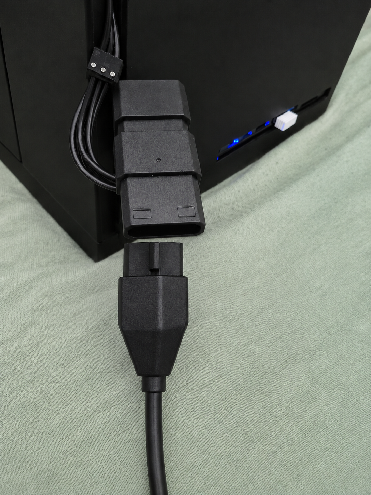

# Troubleshooting — v0.4.0

[Português](troubleshooting-v0.4.0.pt.md)

Issues encountered while integrating the Galaxy S10+ into the Linudex v0.4.0 enclosure, including diagnoses, implemented solutions and known limitations.

Software issues already documented in previous releases are not repeated here unless directly related to the physical build.

## Issue index

- [Fan adapter connector did not match the large Molex plug](#fan-adapter-connector-did-not-match-the-large-molex-plug)
- [Faint charger noise with fans switched off](#charger-produced-noise-under-a-low-load-condition)
- [Power button pressed by the mounting bracket](#power-button-was-pressed-by-the-enclosure-mount)
- [Secondary hub USB-C port did not charge the phone](#secondary-hub-usb-c-port-did-not-charge-the-phone)
- [Rear audio jack moved inward when inserting a plug](#rear-audio-jack-moved-inward-when-inserting-a-plug)
- [Volume and Bixby buttons partially pressed](#volume-and-bixby-buttons-remained-partially-pressed)
- [No external Power button](#enclosure-has-no-external-power-button)

---

## Power button was pressed by the enclosure mount

### Symptoms

With the Galaxy S10+ in its initial position inside the mini enclosure, the screw-adjusted mounting bracket applied pressure to the side Power button. The amount of pressure depended on how tightly the mount was secured.

This could cause unintended button activation and increase the risk of physical wear or damage.

### Diagnosis

The issue resulted from the smartphone's position relative to the inner wall and mounting point of the enclosure, not from an Android or Power button malfunction.

The direct USB-C connection to the hub limited the possible phone positions.

### Solution

A **male-to-female USB-C extension cable** was installed between the Galaxy S10+ and the USB-C hub. It allowed the phone to be mounted in the opposite orientation, keeping the Power button clear of the bracket without modifying the enclosure structure.

### Validation

The extension worked with the hub in the tested setup, preserving the phone's connection after repositioning. The bracket no longer pressed the Power button in the new position.

### Status

**Resolved in the current build.**

---

## Secondary hub USB-C port did not charge the phone

### Symptoms

When the charger was plugged into one of the hub's two female USB-C ports, the indicator LED turned on, but the Galaxy S10+ did not charge through that connection.

### Diagnosis

The hub manual clarified the different purposes of its two USB-C ports:

```text
USB-C female port 1: PD input (20V@3A; adapter up to 87W, per manual)
USB-C female port 2: High Speed USB-C; peripheral power up to 4.5W
```

The second port is intended for USB-C peripherals and can supply power to them; it is not a second PD input for charging the phone. An illuminated indicator LED alone does not confirm that the phone is charging.

### Solution

The charger must be connected to the **first female USB-C port (PD-IN)**. The second port remains available for compatible USB-C peripherals.

### Status

**Behavior explained by the manual; no hub defect was confirmed.**

---

## Rear audio jack moved inward when inserting a plug

### Symptoms

A 50 cm, 3.5 mm audio extension cable was installed to expose the Galaxy S10+'s headphone output through a rear enclosure opening above the hub's Ethernet port.

The initial electrical-tape mounting did not prevent the female jack from being pushed back inside the enclosure when a plug was inserted.

### Diagnosis

The tape held the cable in approximately the right position but did not provide sufficient axial retention to withstand plug insertion force.

### Solution

A retaining mount was assembled from rubber washers of different sizes, bonded together with cyanoacrylate adhesive (Super Bonder). A paintbrush was used as a makeshift mandrel to size the central opening.

The procedure included:

- Bonding and aligning the washers around the paintbrush.
- Gradually enlarging the opening until the P2 jack could be inserted with a tight fit.
- Bonding the washer assembly to the inner enclosure wall with cyanoacrylate.
- Allowing approximately 24 hours for the assembly to cure.
- Covering visible adhesive marks on the outside with small pieces of electrical tape.

### Validation

The jack remained firmly seated in the rear opening without the previously observed inward movement. It can still be removed, although the fit is very tight.

### Status

**Resolved in the current build.**

---

## Volume and Bixby buttons remained partially pressed

### Symptoms

After reversing the Galaxy S10+ orientation to free the Power button, the enclosure mount applied some pressure to the volume and Bixby side buttons.

### Diagnosis

This limitation is caused by the available space and mounting geometry inside the mini enclosure. The new position prioritizes keeping the Power button free.

### Decision

The current mounting position was retained for the time being. No related functional failure has been reported, but the condition should be monitored: continuously pressed buttons can trigger unintended actions or cause wear.

### Status

**Known limitation of the current build; no further fix implemented.**

---

## Enclosure has no external Power button

### Situation

The enclosure does not provide a dedicated external actuator for the Galaxy S10+'s Power button. In the current arrangement, the phone's physical button is not conveniently accessible while the assembly is installed.

### Diagnosis

A mechanical button extension would require additional clearance or modifications to the enclosure. An electrical modification to the phone's Power button was not pursued.

### Decision

Linudex v0.4.0 remains without an external Power button. For everyday use, Android can be kept powered on while only the Linudex environment is started or stopped, avoiding unnecessary complete shutdowns.

This does not replace physical Power button access for freezes, full shutdowns or maintenance.

### Status

**Accepted design limitation in v0.4.0; possible future enhancement.**

---

## Fan adapter connector did not match the large Molex plug

### Symptoms

The DC5521-to-fan adapter arrived with a small four-pin output, which did not mechanically mate with the fans' large peripheral Molex connectors.

### Diagnosis

The product was advertised as DC5521 to 4-pin PWM fan connector, not DC5521 to the larger IDE/LP4 peripheral Molex type. Both are sometimes called four-pin connectors, despite different dimensions and pinouts.

### Solution

Another small connector was identified on the fan assembly. It fit the purchased adapter, and **both fan motors spun when power was applied through that single connection**. No plastic shells were removed, wires cut or external splitter purchased. The electrical interconnection between the fans comes from the link between their LP4 Molex connectors.

### Validation

Both fans ran for 20 minutes without reported failures. Actual supply voltage, polarity and current remain unmeasured; this verifies operation, not complete electrical compliance.

### Status

**Mechanical mismatch bypassed; instrumented electrical verification pending.**



---

## Charger produced noise under a low-load condition

### Symptoms

A faint high-pitched sound was noticed at the charger under certain conditions. In a subsequent test, the sound was not noticeable while charging the S10+, while supplying only running fans, or while supplying both. It was noticeable when the fan cable remained connected but its in-line switch turned the fans off.

### Diagnosis

One possible explanation is magnetic-component noise in a low-load operating mode of the switching supply. The observed sound does not establish this mechanism or rule out an electrical fault.

### Decision

The build was monitored during testing. The sound was not classified as a confirmed defect; instrumented verification of PD profiles and the nominal 12 V trigger output was deferred. Power should be disconnected if clicking, odor, abnormal heat or intermittent operation occurs.

### Status

**Observed behavior; cause unconfirmed and electrical measurements pending.**
